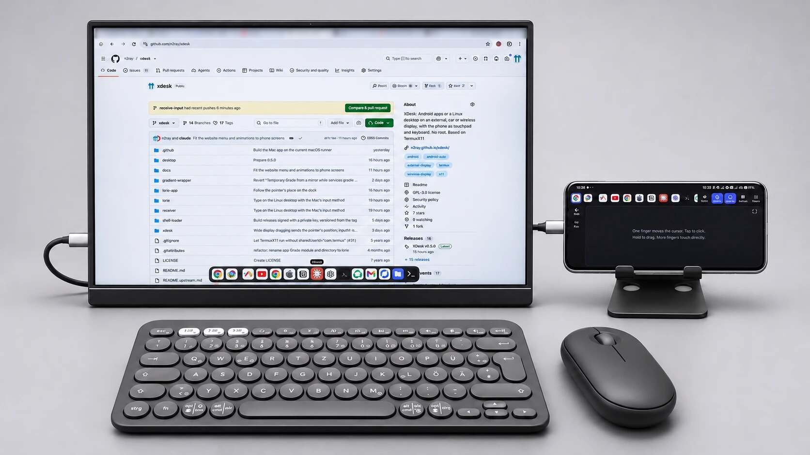
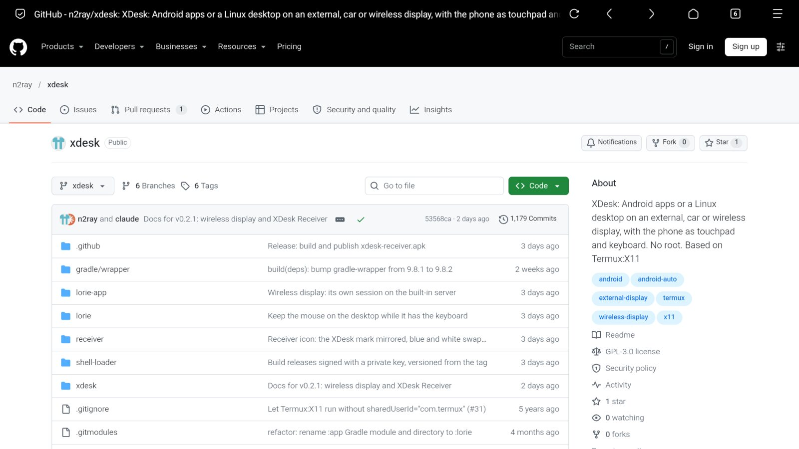
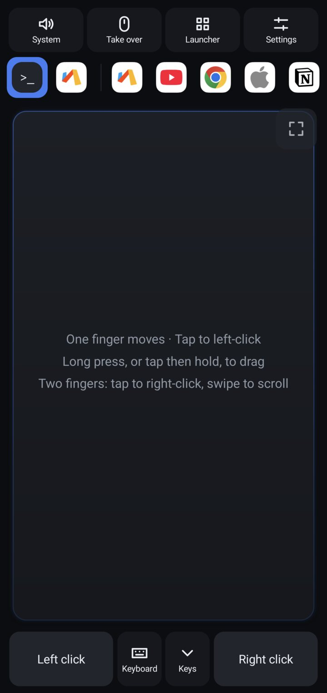
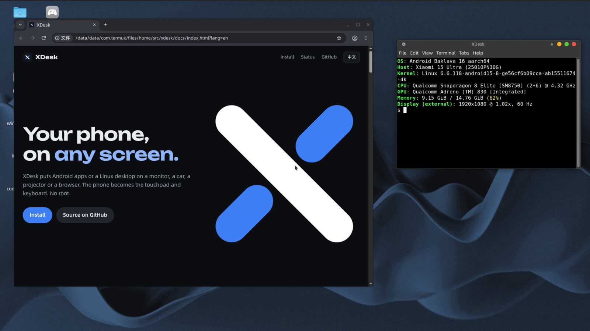

# XDesk

<p align="center"></p>

**Put Android apps on the big screen from your phone, with no root.** Install one APK, activate it once, connect a screen, and your Android apps run full screen on it, with the phone as touchpad and keyboard. The display gets a home screen of your favourites and a dock at the bottom edge, so it feels much like a computer. From there you can add Linux desktops through Termux, cast over Wi-Fi to another Android device, use XDesk on a Mac as the big screen, or use any browser as the display.

| Screen | How it connects |
|---|---|
| Monitor, portable screen or dock | USB-C video output, the lowest latency |
| Car | Android Auto, parked only (experimental) |
| Projector, TV box or old phone | Wi-Fi, to XDesk Receiver |
| Mac with Apple silicon | USB or Wi-Fi, with the [XDesk Mac app](#mac-receiver) and the Mac's keyboard and mouse |
| iPad, laptop or smart TV | Any browser, nothing to install there |

**[Website](https://n2ray.github.io/xdesk/)** · [中文说明](README.zh-CN.md) · The Linux desktop is based on [Termux:X11](https://github.com/termux/termux-x11) ([upstream README](README.upstream.md)) · GPL-3.0 · [Built by me and Claude](#built-by-me-and-an-ai)

> **Status:** an early personal project that works daily on one device, the European (EEA) Xiaomi 15 Ultra (model 25010PN30G, Snapdragon 8 Elite, HyperOS 3, Android 16, locked bootloader). It has not been tried anywhere else, including the Chinese version of the same phone. Other phones and ROMs may behave differently. The UI follows the system language: English, or Simplified Chinese when the phone is set to it. On Android 13 and later you can also pick the language in XDesk's settings. Reports from other devices are very welcome.

## Quick start

Android 11 or newer (only tested on Android 16). No root, no computer and no other app needed.

### 1 Install the app

Download `xdesk.apk` from the [latest release](https://github.com/n2ray/xdesk/releases/latest) and install it. If your file manager reports "app not installed", use `adb install -r xdesk.apk`; on Xiaomi phones, first turn on **USB install** in Developer options.

From v0.2.0 the APK is signed with XDesk's own release key. v0.1.x used upstream's public test key, so Android refuses to update it: uninstall the old XDesk first.

### 2 Activate it once

Android doesn't let normal apps send input to other apps, so XDesk starts a small service of its own through wireless debugging. Open XDesk and follow its activation page:

1. Connect to Wi-Fi. It is only needed while activating, and the phone's own hotspot probably doesn't count.
2. In Developer options, turn on **Wireless debugging** and tap **Pair device with pairing code**.
3. Type the 6-digit code into XDesk, in its notification or on its activation page.
4. Allow the overlay permission when XDesk asks, so it can draw a cursor on the display.

On Xiaomi phones, also turn on **USB debugging (Security settings)** in Developer options and allow the permission to get installed apps. Already using [Shizuku](https://shizuku.rikka.app/)? XDesk can use it instead. A reboot needs activation again.

### 3 Connect a screen

Connect a monitor with a USB-C to HDMI cable or dock, and open **XDesk**. The phone needs **video output over USB-C** (DisplayPort Alt Mode): if plugging in a monitor mirrors the screen, it qualifies. Then tap an app. Nothing starts until you choose.

<p align="center"> </p>

### Then add what you want

- [Linux desktops](#linux-desktops-with-termux), through Termux
- [Another Android device as the display](#wireless-display), over Wi-Fi with XDesk Receiver
- [Any browser as the display](#web-display)
- A car through Android Auto, parked only (see [What you get](#what-you-get))

## Android apps on the display

The home screen of the external display shows the phone's favourites as a grid: click one to open it, and manage them on the phone. Over an app, rest the pointer on the very bottom of the screen and a dock comes up with the current app, the previous app and the favourites, and goes away when you move off it. With the input method open the dock sits above it. It can be turned off in the settings, and there is no dock on Linux desktops.

Tap an app in the chooser to run it full screen on the external display, with the phone as its touchpad and keyboard. A physical mouse and keyboard stay with the phone until you press **Take over** in the top bar or Ctrl+Alt+M, and **Give back** or the same keys again return them. With a physical keyboard, taking over also moves the input method's candidates to the display, next to the text, and giving back returns them to the phone. **Launcher** shows the launcher over the session and changes nothing on the display. **Back to touchpad** closes it.

- **Activation, with no other app.** Android does not let normal apps inject input into other apps, so a small service of this APK runs as the shell user. It reads `/dev/input` and injects events. XDesk starts it itself through wireless debugging (Android 11 or later). You turn on wireless debugging and enter the pairing code once, in the notification or on XDesk's activation page. Then XDesk starts the service whenever it opens with wireless debugging on. Termux sessions need none of this.
  - Activating needs a Wi-Fi connection: Android switches wireless debugging off without one, and the phone's own hotspot probably does not count. Once the service runs, Wi-Fi can go away.
  - A reboot needs activation again. If the service managed to give XDesk the `WRITE_SECURE_SETTINGS` permission, XDesk turns wireless debugging on when you open it with Wi-Fi connected, and off again once the service runs. Otherwise, it says what to do. Some systems refuse that permission.
  - Do not turn off USB debugging or developer options while it runs.
  - The service stays running after you end XDesk, holding no input, sound route or display setting, and only XDesk's uid can call it. It stops at a reboot, when XDesk is updated or removed, or with **Stop built-in service** in the settings.
  - XDesk's key stays paired until you revoke it in the developer options. With wireless debugging on, that key can open a shell on the phone, as for any paired device.
- **[Shizuku](https://shizuku.rikka.app/) still works.** If it is running and has allowed XDesk, XDesk uses it instead and the service runs through it, as before.
- **Needs the overlay permission,** because Android keeps its own pointer on the phone and XDesk draws a cursor on the display.
- **Dock and switching.** The chooser has search by name or package. The star on a row adds it to a dock. Long pressing an icon, in the dock or the list, opens a card with what is remembered for that app: dock position, interface size, mouse or finger, and closing it. The dock stays on the touchpad screen, and one tap switches what is on the display without going back to the chooser. An app that is already running comes to the front with its state. A desktop keeps running behind an app and an app's task stays behind a desktop, as long as Android does not close it. Desktop audio is silent while an app is in front.
- **Cursor in RustDesk.** During a remote session XDesk's cursor is a small faint dot over the remote picture, so it stays out of the way of the remote cursor but still shows on RustDesk's own screens. It is the normal cursor over the toolbar and for a few seconds after a toolbar click. It detects a session from a window flag seen in one version. If that is wrong, turn on the setting to always show the cursor.
- **Android Back.** The **Back** key sends Back to the app on the display, for apps that rely on the edge swipe, and a mouse's side buttons send Back and Forward. In a RustDesk session the side buttons keep going to RustDesk. If Back leaves no app on the display, the list opens. It also goes to an app that Back uncovers.
- **Two input modes, per app, and the cursor shows which.** **Mouse & keyboard** has XDesk's black arrow and is keyboard and mouse: the phone's touchpad, buttons and keys, and a physical mouse and keyboard. **Touch** is for apps and pages that only listen to touch, and has a rounded black arrowhead, which hides when still, so you can keep watching the big screen: one finger moves the cursor, a tap is a tap at the cursor, tap then press and slide is a drag, and press and hold is a long press. Two or more fingers, up to five, are real fingers placed around the cursor, with a dot on the display for each, so pinches and swipes pass through. A physical mouse then acts as fingers, left as one, right as two, and the wheel as a swipe. XDesk remembers the mode per app, the default is Mouse & keyboard, and RustDesk stays at Mouse & keyboard.
- **Full screen touch area.** An icon in the touch area's corner makes it the whole phone screen, with the system bars hidden, and XDesk remembers this. Small translucent corner icons give Back and the keyboard, and leave full screen, as does the phone's Back. In Mouse & keyboard mode the left and right buttons go away, since tap, two-finger tap and hold-to-drag cover them.
- **Keyboard.** Apps raise the phone's soft keyboard on the phone. The display's input method setting changes only while you have taken over with a physical keyboard, and is put back when you give back, when the session ends, or when the service dies.
- **Dashboard.** With XDesk open and a display connected, the display shows a clock and status under whatever runs on it, and that is what appears when an app exits. **End XDesk** removes it, and mirroring returns.
- **Ending the session.** The display stays as it is until you end XDesk with **End XDesk** (in the settings), or by swiping it away from recent tasks. Then apps on the display move back to the phone, not closed, the display returns to mirroring, input is released, and the sound route and interface size are reset. A Termux desktop keeps running without its window, and the launcher shows it as running. Moving apps needs the injector service. Without it they stay on the display, and XDesk says so. Going to the launcher or to the home screen ends nothing: taken input stays taken, and Ctrl+Alt+M still works.
- **XDesk never restarts a desktop by itself.** If the X server stops, the launcher says so and the session can be started again with a tap.
- **Interface size of the display.** A number in settings sets the default density from 120 to 220 dpi while an Android app is on the display, remembered per physical display. An app can have its own number on its card, which applies before it starts and whenever you switch to it. Density only changes when the value differs, because apps reconfigure. The cursor keeps its size, set from the display's height. It is reset when the session ends, so mirroring is normal again. While a Termux desktop is showing, the display uses a separate number, 168 dpi by default and set in the same place. It only sizes Android's windows there, such as the input method's candidates; the desktop has its own DPI setting. On HyperOS a cleared density falls back to the phone's own, so XDesk sets the display's own value instead. It needs the injector service.
- **RustDesk's input relies on its internals.** Flutter breaks drags from normal mouse events there, so XDesk sends button changes as hover events, and guesses when a click is meant for RustDesk's own toolbar. A RustDesk update may break this. Packages with their own method are listed in `AppInputProfile.java`. Everything else gets normal Android mouse events.
- **The phone keyboard can only send what a keyboard can type.** Chinese and other IME text does not reach Android apps.

## Linux desktops with Termux

<p align="center"></p>

Optional, and Android apps need none of it. This part needs [Termux](https://github.com/termux/termux-app). Run this in Termux:

```sh
curl -fsSL https://raw.githubusercontent.com/n2ray/xdesk/xdesk/xdesk/install.sh | bash
```

It installs the `xdesk` command and its loader, looks for desktops you already have, and downloads the app, which you can ignore if it is already installed. No desktop yet? For example: `pkg install xfce4 xfce4-terminal && xdesk setup`. Your sessions then appear in XDesk's launcher.

> Please read scripts before piping them to a shell: [install.sh](xdesk/install.sh).

XDesk's lifetime is separate from any desktop. Opening or swiping away XDesk never starts or stops XFCE. A Termux desktop is one entry in the launcher, and you start and stop it yourself.

XDesk only provides the display. Anything that can reach its X socket can show up on it.

```sh
xdesk x                 # start only the X server and audio
xdesk run CMD...        # run any program on the display
xdesk setup             # look for desktops in Termux and proot-distro
xdesk list              # list sessions, * marks the default
xdesk use NAME          # choose the default session
xdesk start [NAME]      # start a session
xdesk switch NAME       # stop the current session and start another, the window stays
xdesk add NAME 'CMD'    # add your own session
xdesk rm NAME           # remove a session
xdesk status            # what is running
xdesk stop              # stop everything
```

A session is one command, stored in `~/.config/xdesk/sessions/NAME.sh`. Edit these files freely, `xdesk setup` will not overwrite them.

| Environment | How to connect |
|---|---|
| Termux | Found by `xdesk setup`, or `xdesk run xterm` |
| proot-distro | Found by `xdesk setup`. By hand: `xdesk add box "proot-distro login ubuntu --shared-tmp -- env DISPLAY=:1 PULSE_SERVER=127.0.0.1 PULSE_COOKIE=/tmp/xdesk-pulse-cookie dbus-launch --exit-with-session startxfce4"` |
| Plain proot | Bind `$PREFIX/tmp` to `/tmp` and set `DISPLAY=:1` |
| chroot (root) | Bind `$PREFIX/tmp/.X11-unix` to `/tmp/.X11-unix` in the chroot, set `DISPLAY=:1`. Untested so far |

GPU acceleration is only set up for Termux on Adreno (zink + Turnip). Inside proot or chroot, expect software rendering unless you configure Mesa there yourself. That is fine for debugging, not for games.

Audio from proot and chroot reaches the app through PulseAudio on `127.0.0.1`.

### Starting from the app

The launcher lists your sessions and starts the one you tap, which needs permission to run commands in Termux. Without it, the launcher offers **Attach an X display**, and you run `xdesk start` yourself. To allow it:

```sh
xdesk enable-app-start
```

This sets `allow-external-apps = true` in Termux, so apps can ask to run commands there. Each app also has to be granted the permission, and XDesk asks for it when you tap a session.

A session that is already running is marked in the launcher. Tapping it reattaches without restarting anything. Its **Stop** button, or **End Termux desktop** in the settings, is how you stop it, because leaving XDesk does not. `xdesk stop` also works.

## Wireless display

No cable? Install **XDesk Receiver** (`xdesk-receiver.apk` from the [releases](https://github.com/n2ray/xdesk/releases)) on another device on the same network: an old phone, a projector or a TV box, Android 5.0 or later. XDesk then streams a display to it over Wi-Fi, and everything works as on a cable: Android apps, a Termux desktop and the sound. The receiver only shows the picture and plays the sound; all input stays on the phone.

1. Open XDesk Receiver on the other device. It shows its name and address and waits.
2. In XDesk, open settings → **Display** → **Wireless display** and choose the receiver. It is found over mDNS; across subnets, use **Enter address** with the address shown on the receiver.
3. The first time, type the 4-digit code shown on the receiver. Paired devices connect without a code from then on.

- **Needs the injector service** (built-in or Shizuku): it creates the display that is streamed. The wireless display has its own session in the service, so apps starting and ending do not touch it, and XDesk makes the display again if the service drops it.
- **Video** is H.264 at the receiver's screen size, capped at 1920 on the long side and to what its decoder handles, at about 12 Mbit/s for 1080p, decoded with low latency. **Sound** is the phone's whole output, captured as PCM and played on the receiver while the phone is silent. It follows the same sound output setting as a cable: system default goes with the display, here the receiver; choosing one of the phone's outputs, e.g. headphones, keeps the sound on the phone. It can be changed while streaming.
- **Stop** from the same settings row, with **End XDesk**, or by closing the receiver.
- Once paired, each side proves it holds the token without sending it. The pairing code, the token issued at pairing, and the picture and sound still travel unencrypted, so pairing keeps other phones from casting by accident but does not protect against someone who can read the network. The protocol is in [receiver/PROTOCOL.md](receiver/PROTOCOL.md).

## Mac receiver

Shows the phone's picture and sound in a window on a Mac, with the Mac's keyboard and mouse. For Macs with Apple silicon: [download `XDesk-macos-arm64.dmg`](https://github.com/n2ray/xdesk/releases/latest/download/XDesk-macos-arm64.dmg), the same version as on the phone. In my tests it took about 15 to 20 ms from the phone to the Mac over USB.

- **First start:** the app is self-signed, so macOS stops it. Choose **Open Anyway** in **System Settings → Privacy & Security**. Then turn on XDesk under **Accessibility** so that the keyboard can go to the phone. The window says so, and there is no need to restart.
- **Connecting:** with a cable and USB debugging it connects over USB, and back over Wi-Fi when the cable is pulled. Without a cable, pick this Mac under Connect to a receiver in XDesk on the phone. The first time asks for a pairing code.
- **Use:** rest the pointer on the window's top edge for Back, Home, Recents, Full screen and Disconnect, also in the Phone menu. Drop a file on the window to send it to the phone's Downloads, and choose Send to computer in the phone's share sheet to send one to the Mac's Downloads. Text on the clipboard is shared; it can be turned off under Connect to a receiver. On the Linux desktop you type with the Mac's input method, and Control+Space switches it; in Android apps you use the phone's.
- **Keys:** Control+Option with Esc (give the keyboard and mouse back to the Mac), F (full screen), B (back), H (home), R (recents), D (latency panel), L (low latency).

## Web display

Any device with a browser can be the display: an iPad, a laptop, a smart TV. No app to install. Turn on settings → **Display** → **Web display**; XDesk then serves a page on port 47150 and lists the addresses to open, by network:

- **Wireless:** the phone's Wi-Fi address, or its hotspot's address when the other device joins the hotspot.
- **Wired:** connect a USB cable and turn on **USB tethering** (the row opens the tethering settings). A wired address appears. The delay is lower and steadier than over Wi-Fi. iPad and Mac only speak NCM over USB: tap **USB tethering as NCM** first (it needs the permission the built-in service gives; otherwise run `adb shell settings put global tether_force_usb_functions 1`), then turn tethering off and on.

The first time, the browser asks for a 4-digit code that XDesk shows on the phone; it remembers the phone from then on. You get the picture, the phone's sound, and the browser's mouse, keyboard and touch:

- **Mouse:** your computer's own pointer, at its own speed and with no delay. The desktop's pointer is hidden meanwhile, so the pointer's shape does not change over text or links; it comes back when you use the phone's touchpad, and the computer's pointer is hidden until you move the mouse again. Buttons and the wheel go to the display. Adding `?lock` to the address captures the mouse instead (Pointer Lock, Esc releases it), for games that need relative movement.
- **Touch** works as the phone's touchpad: one finger moves, tap clicks, tap and drag drags, two fingers scroll, a two-finger tap is a right click, three fingers a middle click.
- **Keyboard:** characters are the ones the computer's keyboard really types, so a German Mac keyboard works as itself. Shortcuts go as key codes; on Mac and iPad keyboards Command acts as Ctrl. Text from input methods (Chinese, the iPad's soft keyboard through ⌨) goes as text.
- **Taking over:** a browser takes over when it connects, even with no mouse or keyboard on the phone, and the phone's input method then shows its candidates in the page. **Give back** brings the phone's soft keyboard back.
- **Staying on the page:** the toolbar at the top (move the mouse up or touch the top edge) has full screen, keyboard, sound and disconnect. Back is blocked and leaving asks first; the page does not zoom, scroll, select or show menus. In Chrome full screen, Esc and browser shortcuts go to the display too. On the iPad, **Add to Home Screen** opens it full screen like an app.

It shares its machinery with the wireless display, so there is one browser or receiver at a time, it needs the injector service, and XDesk must stay open on the phone. The page is plain HTTP: the pairing token, picture, sound and input are not encrypted, so use it only on networks you trust. To keep it as a window of its own, use the browser's full screen or, in desktop Chrome, a shortcut opened as a window. Video is H.264, decoded with WebCodecs where the browser allows it (localhost, HTTPS) and otherwise with Media Source Extensions, which works on plain HTTP in Safari, Chrome, Edge and Firefox. The page and protocol are in `lorie-app/src/main/assets/web/` and [receiver/PROTOCOL.md](receiver/PROTOCOL.md).

## What you get

- Phone as touchpad: move, tap, two-finger right click and scroll, long press or tap-and-hold to drag
- Soft keyboard with IME text input including Chinese, and a shortcut row (Esc, Tab, Ctrl, Alt, Super, Shift, arrows)
- Physical mouse and keyboard, forwarded to the desktop. **Take over** in the top bar gives the desktop window the keyboard and mouse directly, so a physical keyboard's input method candidates show on the display; **Give back** returns them to the phone. Taking over needs the injector service
- Android apps full screen on the display, activated through wireless debugging or Shizuku
- The display's home screen shows the phone's favourites as a grid. Over Android apps, resting the pointer on the bottom edge brings up a dock with the current and previous app and the favourites; it can be turned off in the settings
- Wireless display: the same over Wi-Fi to XDesk Receiver on a projector, TV box or old phone, with sound
- Mac app: over USB or Wi-Fi, moving between them by itself, with text and files shared. See [Mac receiver](#mac-receiver)
- Audio output you can switch: phone speaker, HDMI, Bluetooth, USB, wired, or system default. It is one setting for every mode and survives switching. With the injector service running, it sets the system's preferred media device, which covers desktops, Android apps and everything else, and clears it when you return to the chooser or exit. The next session applies your choice again. Without it, this is best effort for desktop audio only: on the test phone it could not bring sound back to the phone speaker while HDMI was connected. It only points output at the device, and says nothing about quality or Bluetooth codecs. If XDesk is killed so hard that it cannot clear the preference, choose system default in XDesk once, or reboot
- Resolution presets, sensitivity, portrait or landscape touch screen, dim the phone when idle
- Survives unplugging the display, switching apps and locking the phone
- Android Auto, parked only (experimental): XDesk appears among the car's apps and shows a clock on the car's screen. From the phone you can run a Linux desktop there, sized to the car's screen, with the phone as touchpad and keyboard, and its sound plays in the car. Android apps (YouTube, Chrome and others) run there too, on a display XDesk makes for them, and the car's touch screen works on them. With an external display also connected, the external display is used

It installs next to the official Termux:X11 and does not touch it. Do not run both at once, since both use display `:1`.

## How it works

```
 Phone screen                        External display
┌───────────────────────┐           ┌───────────────────────┐
│ XDeskActivity         │  direct   │ MainActivity (upstream)│
│ touchpad, keys, audio ├──calls───►│ LorieView shows X      │
└───────────┬───────────┘           └───────────▲───────────┘
            │ local port (audio)                │ X11 socket
┌───────────▼───────────────────────────────────┴───────────┐
│ xdesk: X server, PulseAudio                               │
│ Termux, proot, chroot: your desktop or program            │
└───────────────────────────────────────────────────────────┘
```

- **One app, two windows.** The upstream `MainActivity` runs unchanged on the external display. `XDeskActivity` runs on the phone in the same process and calls `LorieView.sendMouseEvent`, `sendKeyEvent` and `sendTextEvent` directly.
- **The X server runs in Termux**, started with a loader built for this app id.
- **Android apps** are started on the display with the injector (`InjectorService`), which runs as the shell user and sends events with `injectInputEvent`. `CursorOverlay` draws the pointer.
- **Audio** goes from a PulseAudio null sink through a socket in Termux's private directory; the X server hands the app a connection to it. The app plays it with `AudioTrack`, which is how it can pick the output device without special permissions. Clients in proot or a chroot reach PulseAudio on `127.0.0.1:4713` with its cookie, since every app on the phone can reach that port. `xdesk` sets `PULSE_COOKIE` for its sessions and adds it to proot-distro sessions. A chroot or other setup of your own needs `PULSE_COOKIE` set to `$PREFIX/tmp/xdesk-pulse-cookie` as seen from inside it. If that is not possible, `touch ~/.config/xdesk/pulse-anonymous` restores the old port without a cookie, which any app on the phone can use to record the desktop sound and control PulseAudio.
- **Wireless display:** the injector creates a public display whose surface is a MediaCodec H.264 encoder, and records the phone's output through `REMOTE_SUBMIX` (`WirelessDisplay`, `OutputCapture`). XDesk connects to the receiver on port 47140 and treats that display as its external display.

Almost all changes live in `lorie-app/` and `xdesk/`, so merging upstream stays simple.

## Troubleshooting

Logs are in `$PREFIX/tmp/xdesk.log`.

| Symptom | Likely cause |
|---|---|
| Waiting forever | You attached to the X display and nothing is running yet. Run `xdesk start`, and check `xdesk status` |
| No sessions in the chooser | Run `xdesk enable-app-start` and `xdesk setup`, and allow XDesk to run Termux commands |
| Android app list is short | Some ROMs limit what apps can see. On Xiaomi, check the permission to get installed apps |
| Injector service does not start | Check that Wi-Fi is connected and wireless debugging is on, then return to XDesk. It has to be activated again after a reboot. With Shizuku, check that Shizuku is running |
| Pairing fails or the notification takes no input | Keep the pairing dialog open. Enter the code on XDesk's activation page, using split screen or a small window if leaving Settings closes the dialog |
| "Display :1 is used by another X server" | The official Termux:X11 is running. Stop it, for example with `pkill -f termux-x11` |
| App's start button fails | Run `xdesk enable-app-start` and check the permission |
| Desktop does not fit the screen | It started before the app connected. Open the app first, then restart the session |
| External screen goes black after a few minutes | XFCE's screensaver. Move the mouse, or raise `/saver/idle-activation/delay` in the `xfce4-screensaver` xfconf channel |
| Phone's own cursor appears | Mouse capture was lost. Tap the XDesk touch screen |
| No sound | Check the output in the top bar. Many monitors have no speakers |
| Ctrl + letter does nothing on the soft keyboard | Pinyin mode keeps the letter in the IME. Switch to the English layout or use a physical keyboard |
| Android apps get no input on Xiaomi | Turn on **USB debugging (Security settings)** in Developer options |
| Flickering blocks in GPU programs on the car | Turnip's tiled rendering is interrupted by the composition of Android Auto's display. Start them with `TU_DEBUG=sysmem`; for Chromium, `--use-angle=gl --disable-features=Vulkan` is also faster |

## Limitations

- Android apps need activation through wireless debugging or Shizuku, and only one full screen app or desktop can use the display at a time
- Android Auto: only while parked. When Android Auto closes XDesk or disconnects, the desktop keeps running without its window, and Android apps keep running and come back when XDesk is opened on the car again. DRM video (some streaming apps) may be black on the car. Android apps on the car need activation, as on an external display, and go back to the phone when the session ends
- Termux and XDesk must both stay alive. Aggressive system cleaners can kill them
- Wireless display: one phone per receiver, picture and sound only, and only as smooth as the Wi-Fi. Tested with a 32-bit Android 9 projector
- Used daily on a single phone, the European Xiaomi 15 Ultra, and barely tested on others
- The Mac app is for Apple silicon and tested on one M4 Mac. It is self-signed, and over Wi-Fi it is not encrypted, like the other wireless modes. Typing on a Linux desktop with the Mac's input method puts the candidates under the pointer, not at the text cursor. There is no Windows or Linux version yet

## Building

The default branch is `xdesk`, `master` tracks upstream. Pushes build on GitHub Actions, and tags like `v0.2.0` publish a release, signed with the key in the repository secrets (see `.github/workflows/release.yml`). A tag with a suffix, such as `v0.3.0-rc1`, publishes a pre-release.

```sh
git clone --recursive https://github.com/n2ray/xdesk
cd xdesk && ./gradlew assembleDebug      # needs the Android SDK and NDK
```

To merge upstream:

```sh
git remote add upstream https://github.com/termux/termux-x11
git fetch upstream && git merge upstream/master
```

The Mac app is in `desktop/`, written in Rust. On a Mac with Rust and Homebrew's `sdl2`, run `cargo build --release` in that directory. `desktop/packaging/build-app.sh` makes the package.

XDesk relies on upstream's manifest, class names under `com.termux.x11` and the `LorieView` API. The app id is set in `lorie-app/build.gradle` and `shell-loader/build.gradle`, and they must match.

## Built by me and an AI

I'm [n2ray](https://github.com/n2ray), and I build XDesk together with Claude, an AI. I decide what XDesk should do and test it on real phones, monitors, projectors, cars and Macs. Claude wrote most of the code and documentation, including this README.

## License

GPL-3.0, same as Termux:X11. All credit for the X server and rendering goes to the [Termux:X11 authors](https://github.com/termux/termux-x11).
