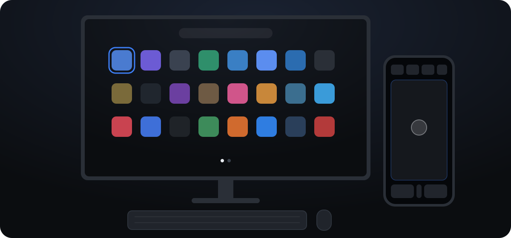

# XDesk

<p align="center"></p>

**把手机变成任何屏幕上的电脑。** 一个 App，在显示器、投影、平板或车机上跑三样东西：**安卓应用**、**内置 Ubuntu** 桌面、你的 **Mac**。XDesk 给它们当显示器和键鼠，手机当触摸板、键盘、手柄或启动台。不用 root，也不用另装别的。

**[网站](https://n2ray.github.io/xdesk/?lang=zh)** · [下载](https://github.com/n2ray/xdesk/releases/latest) · [English](README.md) · [使用手册](MANUAL.zh-CN.md) · GPL-3.0

## 能干什么

不是每台手机都有 DeX 或桌面模式，也不是每块屏都插得上线。XDesk 补上这一块，大屏上能跑三样东西：

| 大屏上跑什么 | 需要什么 | |
|---|---|---|
| **安卓应用**，全屏 | 不用另装：XDesk 自带注入服务，无线调试里配对一次（或用 Shizuku） | 手机里的应用、游戏、云游戏 |
| **内置 Linux**：Ubuntu 26.04 加 XFCE | 不用另装：XDesk 自己运行，第一次下载约 470 MB | apt 随便装，骁龙 GPU 加速，Chrome 视频硬解 |
| **你的 Mac** | macOS 自带的「屏幕共享」（Apple 芯片、macOS 14 以上），或在 Mac 上装 [Sill](https://github.com/Saffsanity/sill) | Mac 桌面带声音，HEVC 或 H.264，按你的屏幕大小 |

能接的屏幕也很多：

| 用法 | 接法 | 手机当什么 |
|---|---|---|
| **当电脑用**：显示器 + 键鼠 | USB-C 视频输出，插上就行 | 启动台或触摸板；键鼠直接用 |
| **配 Mac 干活** | Mac 版 XDesk，数据线或 Wi-Fi | Mac 窗口里的手机；剪贴板和文件两边通 |
| **投影娱乐**：看片、打游戏 | 投影或电视盒子装接收器，Wi-Fi | 手柄（游戏当真手柄认）或遥控器 |
| **平板放大**：手机应用、手游 | 平板装接收器，Wi-Fi | 直接在平板上点，多指也行 |
| **车机**：停车时办公、看视频 | 只支持 Android Auto（不支持 CarPlay），只能停车时用 | 触摸板和键盘 |

还能这样用：

| 用法 | 怎么做 | 实测 |
|---|---|---|
| **云游戏**：GeForce NOW 等 | 大屏开云游戏，接手柄；键鼠游戏按 Ctrl+Alt+G，键鼠直通给游戏，转视角、WASD 和电脑上一样 | GeForce NOW：蓝牙手柄、键鼠直通都流畅，USB-C 显示器和投影接收器上都试过。Steam Link、Moonlight 应该也行，还没试 |
| **手机当手柄** | 大屏开着安卓应用时点「手柄」，手机横过来就是手柄，布局可以改 | 游戏认成有线 Xbox 360 手柄，GeForce NOW 里也能用 |
| **远程桌面**：RustDesk | 在大屏上开 RustDesk，用键鼠或手机触摸板操作远端电脑 | 拖动、侧键、光标都专门处理过 |
| **Mac 窗口上大屏** | Mac 上装原版 [Sill](https://github.com/Saffsanity/sill)（不用装 XDesk），手机上 添加设备 › Mac，输 Sill 显示的配对码或扫码。之后 Mac 的桌面、窗口、应用都能放到手机接的大屏上，锁着的 Mac 也能解锁 | 用 Mac 自己的输入法打字，画质一键切换 |
| **Termux 里的 Linux** | 已经在用 Termux、或想用别的发行版：proot、chroot 的桌面和程序，和内置 Linux 并存 | 骁龙 GPU 加速（Turnip、zink） |
| **浏览器当显示器** | 设置 › 网页显示，iPad、电脑、智能电视打开它给的地址 | 什么都不用装；USB 共享网络比 Wi-Fi 延迟更低 |
| **声音想去哪就去哪** | 手机喇叭、HDMI、蓝牙、USB、有线耳机，一个设置管所有模式 | 无线接收器和网页显示时，声音在那边放，手机静音 |

大屏上有启动台、底部 Dock 和通知；手机这边可以选「操作台」（触摸板为首页）或「启动台」（应用网格为首页），横竖屏都有。

## 怎么用

**1. 安装。** 从[发布页](https://github.com/n2ray/xdesk/releases/latest)下载 `xdesk.apk` 装上。安卓 11 及以上。

**2. 按清单开权限。** 第一次打开，XDesk 列出要开的几项，一项项带你开：连上 Wi-Fi，在开发者选项里打开「无线调试」配对一次，再允许悬浮窗。也可以用 [Shizuku](https://shizuku.rikka.app/)。手机重启后要重新激活。

**3. 接上屏幕。**

| 屏幕 | 怎么接 |
|---|---|
| 显示器 | USB-C 线插上。能镜像手机画面就说明支持 |
| Mac（Apple 芯片） | 下载 [XDesk-macos-arm64.dmg](https://github.com/n2ray/xdesk/releases/latest/download/XDesk-macos-arm64.dmg)，Mac 上装 [Sill](https://github.com/Saffsanity/sill)；插线自动连上，或在手机上选这台 Mac |
| 投影、电视、平板、旧手机 | 装 [xdesk-receiver.apk](https://github.com/n2ray/xdesk/releases/latest/download/xdesk-receiver.apk)（安卓 5 起）并打开，手机上 设置 › 连接接收器 |
| 浏览器 | 手机上 设置 › 网页显示，在浏览器里打开它列出的地址 |
| 车机 | 在 Android Auto 里打开 XDesk，停车时用 |

**4. 可选：Linux。** 手机上 设备 › 添加 › Linux › **内置 Linux**，点安装：Ubuntu 加 XFCE，不要 Termux。已经在用 Termux？装好 [Termux](https://github.com/termux/termux-app)，运行下面这行，再在 XDesk 的「设备 › 添加 › Linux」里加上 Termux（运行前建议先[看看脚本](xdesk/install.sh)）：

```sh
curl -fsSL https://raw.githubusercontent.com/n2ray/xdesk/xdesk/xdesk/install.sh | bash
```

**快捷键**（键盘接在手机上时）：

| 按键 | 作用 |
|---|---|
| Ctrl+Alt+M | 键鼠在外屏和手机之间切换 |
| Ctrl+Alt+N | 打开通知中心 |
| Ctrl+Alt+G | 游戏直通：键鼠直接交给游戏 |
| Ctrl+Alt+Space | 打开 Mac 应用的菜单 |
| Ctrl+Alt+Q | 切换 Mac 画质 |

更多：排错、Linux 命令、各种屏的细节、原理和构建，都在[使用手册](MANUAL.zh-CN.md)里。

## 坦白从宽：要哪些权限

装之前先说清楚。第一次打开时 XDesk 也会列这张清单，之后在 设置 › 权限 随时能看到每一项开没开。

| 权限 | 级别 | 拿来干嘛 | 不给会怎样 |
|---|---|---|---|
| 无线调试（或 [Shizuku](https://shizuku.rikka.app/)） | 必需 | 起一个 shell 身份的小服务，把键鼠和触摸送进大屏上的安卓应用 | 安卓应用在大屏上只能看不能动 |
| 显示在其他应用上层 | 必需 | 在大屏上画光标和启动台 | 大屏上没有光标，基本没法用 |
| 通知 | 推荐 | 配对码直接在通知里输；服务在跑时有常驻通知 | 得进 App 里输配对码 |
| 通知使用权 | 用到再开 | 把手机通知搬到大屏上 | 通知只在手机上响 |
| 运行 Termux 命令 | 用到再开 | 一键开 Linux 桌面 | 不用 Linux 就不用管 |
| 相机 | 用到再开 | 扫码添加 Mac | 手输地址也行 |
| 勿扰 | 用到再开 | 大屏上的勿扰开关 | 那个开关点不了 |
| 自启动（小米等） | 用到再开 | 别让系统掐掉通知转发 | 大屏上的通知时有时无 |

**没要的：** root、无障碍、存储、电话、位置、通讯录。

**说实话的部分：**
- 无线调试配对后，XDesk 的服务和 adb 一样是 shell 身份：能注入输入、建虚拟屏幕、调声音输出，碰不到别的应用的私有数据。只有 XDesk 自己能调用它，重启手机、更新或卸载 XDesk 后就停。配对的钥匙一直有效，直到你在开发者选项里撤销。
- 代码里还留着从 Termux:X11 继承来的一个无障碍服务（拦截系统快捷键用），默认关着，XDesk 不会让你开。
- 无线接收器、网页显示和 Mac 的 Wi-Fi 连接，画面、声音和输入都不加密，只在你信得过的网络上用。

## 声明和感谢

- **只在很少的设备上测过。** 我每天用的是欧版小米 15 Ultra（安卓 16），Mac 版在一台 M4 Mac 上测。别的手机不一定一样，欢迎[告诉我](https://github.com/n2ray/xdesk/issues)结果。
- **无线、网页和 Mac 的 Wi-Fi 连接没有加密**，只在信得过的网络里用。**车上要先停车**，开车时不要用。

**我和AI一起做的XDesk，在我有的设备上进行了测试，也在日常使用。本软件没有质保，没有客服，使用后果自负。** 如果 XDesk 对你有用，可以在 [Ko-fi](https://ko-fi.com/n2ray) 请我喝杯咖啡。

**感谢**

- [Termux:X11](https://github.com/termux/termux-x11)：Linux 桌面基于它，X 服务器和渲染都是它的作者们的功劳（GPL-3.0，[上游说明](README.upstream.md)）。
- [Sill](https://github.com/Saffsanity/sill)（Noah Saffer）：Mac 的连接靠它；XDesk 不是 Sill 官方应用（Apache-2.0）。
- [libinput](https://gitlab.freedesktop.org/libinput/libinput)：触摸板的双指滚动、缩放和轴锁定规则（MIT）。
- [termux_on_dex](https://github.com/PietroCav501/termux_on_dex)（PietroCav501）：X 服务器里的 GPU 绘制 glamor（GPL-3.0）。

XDesk 以 GPL-3.0 开源，许可证全文和第三方许可在 [LICENSE](LICENSE) 和 [LICENSES/](LICENSES/)。
