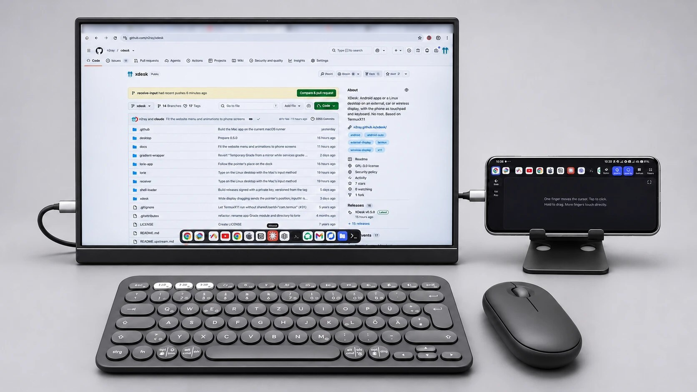
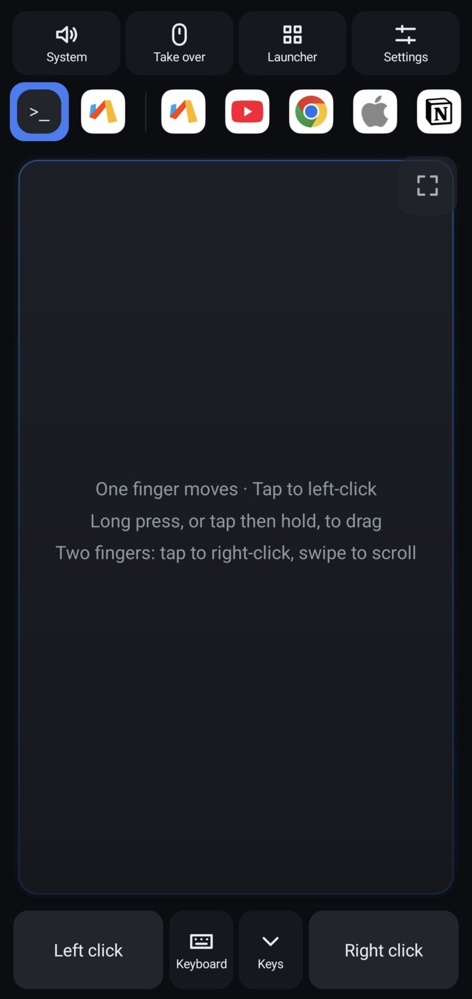

# XDesk

<p align="center"></p>

**手机里的应用，搬上大屏，不用 root。** 装个 APK，激活一次，插上显示器，应用就能在大屏上全屏运行，手机拿来当触摸板和键盘。外接屏首页和手机上的启动器是同一个，光标在屏幕底边停一下就会升起 Dock，用起来很像一台电脑。想要更多的话，还可以用 Termux 跑 Linux 桌面，把 Mac 的窗口和桌面搬到大屏上，用 Wi-Fi 投到另一台安卓设备，用 Mac 上的 XDesk 当大屏，或者用浏览器当显示器。配上手柄或键鼠，再开 GeForce NOW 这类云游戏，手机就是大屏上的一台[游戏主机](#游戏手机就是一台游戏主机)。

| 屏幕 | 连接方式 |
|---|---|
| 显示器、便携屏或扩展坞 | USB-C 视频输出，延迟最低 |
| 车机 | Android Auto，只能停车时用（实验性） |
| 投影、电视盒子或旧手机 | Wi-Fi，投到 XDesk 接收器 |
| Mac（Apple 芯片） | USB 或 Wi-Fi，装 [XDesk Mac 版](#mac)，键鼠直接用 Mac 的；也可以把 Mac 的窗口和桌面搬到大屏上 |
| iPad、电脑或智能电视 | 任意浏览器，那边什么都不用装 |

**[网站](https://n2ray.github.io/xdesk/?lang=zh)** · [English](README.md) · Linux 桌面基于 [Termux:X11](https://github.com/termux/termux-x11)（[上游说明](README.upstream.md)）· GPL-3.0 · [我和 AI Claude 一起做的](#我和-ai-一起做的)

> **现状：** 这还是个早期的个人项目，平时只在一台手机上用：欧版（EEA）小米 15 Ultra（型号 25010PN30G，骁龙 8 Elite，HyperOS 3，安卓 16，BL 未解锁）。其他机型基本没有测试过，包括这款手机的国行版，表现可能不一样，很欢迎告诉我结果。界面语言跟随系统，简体中文显示中文，其他语言显示英文，安卓 13 及以上也可以在 XDesk 的设置里单独选。

## 快速开始

安卓 11 及以上就行（目前只在安卓 16 上测过）。不用 root，不用电脑，也不用装别的 App。

### 1 安装 App

到[发布页](https://github.com/n2ray/xdesk/releases)下载 `xdesk.apk`，装上就行。如果文件管理器提示“未安装应用”，就用 `adb install -r xdesk.apk`；小米手机要先在开发者选项里打开 **USB 安装**。

v0.2.0 起 APK 换了 XDesk 自己的签名。v0.1.x 用的是上游公开的测试签名，安卓不让直接升级，要先卸载旧版。

### 2 激活一次

安卓不让普通应用给别的应用发送键鼠操作，所以 XDesk 要借无线调试启动一个自带的小服务。打开 XDesk，照着激活页面做：

1. 连上 Wi-Fi。只有激活时要连，手机自己开的热点可能不行。
2. 在开发者选项里打开**无线调试**，点**使用配对码配对设备**。
3. 把 6 位配对码输进 XDesk 的通知或激活页面。
4. XDesk 要悬浮窗权限时点允许，否则大屏上没有光标。

小米手机还要在开发者选项里打开 **USB 调试（安全设置）**，并允许读取应用列表。已经在用 [Shizuku](https://shizuku.rikka.app/) 的话，直接用它也行。手机重启后要重新激活。

### 3 接上屏幕

用 USB-C 转 HDMI 线或扩展坞连上显示器，打开 **XDesk**，点一个应用。手机要支持 **USB-C 视频输出**（DisplayPort Alt Mode），插上显示器能镜像手机画面，就说明支持。

<p align="center"> </p>

### 想要更多的话

- [Linux 桌面](#通过-termux-使用-linux-桌面)，通过 Termux，在「添加设备 › Linux」里添加
- [Mac 窗口和 Mac 桌面](#mac)，配成设备；[用 Mac 当大屏](#mac)
- [用另一台安卓设备当显示器](#连接接收器)，走 Wi-Fi，对方装 XDesk 接收器
- [用浏览器当显示器](#网页显示)
- 通过 Android Auto 上车机，只能停车时用（见[功能](#功能)）

## 外接屏上的安卓应用

外接屏的首页是启动台：它和手机上的列表是同一个交换台，一份模型在两边显示。上面有正在运行、收藏、手机和各设备的标签，两块屏共用当前标签与搜索（搜索覆盖所有设备，支持拼音首字母）。在任何内容上——安卓应用、Linux、Mac 都一样——光标在屏幕底边停一下即可打开 Dock，移开后收起。

在启动器里点一个应用，它就在外接屏上全屏运行。实体鼠标和键盘默认控制外屏内容；按 Ctrl+Alt+M 可把键鼠交还给手机，再按一次又回到外屏。

在手机上长按任何一项，或在外接屏上右键点它的图标，都会打开一张卡片：打开、关闭、隐藏、收藏和这项自己的设置都在里面（卡片开在手机上）。正在外接屏上的那一项，卡片里是**打开启动台**：在它上面盖出启动台，不结束它。其他设备的条目图标左下角带一个小徽章（Mac 是一台显示器，Termux 是 `>_`，proot / chroot 是发行名首字母），在收藏和 Dock 里一眼就能分清是谁的。

### 激活

安卓不让普通应用给别的应用发送键鼠操作，所以 XDesk 里带了一个小服务，以 shell 身份运行，由它读取 `/dev/input` 并发送操作。不用装别的 App，XDesk 会通过无线调试自己把它启动起来（需要安卓 11 及以上）。只用 Termux 桌面的话，不需要激活。

- 激活时要连着 Wi-Fi，没有 Wi-Fi 时安卓会关掉无线调试，手机自己开的热点可能也不行。服务跑起来之后，断开 Wi-Fi 也没关系。
- 配对只要做一次。以后打开 XDesk 时，只要无线调试开着，服务会自动启动。
- 手机重启后要重新激活。如果服务拿到了 `WRITE_SECURE_SETTINGS` 权限，XDesk 会在连着 Wi-Fi 时自己打开无线调试，服务启动后再关掉。有的系统不给这个权限，XDesk 会告诉你该怎么做。
- 服务运行期间，不要关闭 USB 调试或开发者选项。
- 结束 XDesk 后服务还在，但不再占用键鼠、声音和显示设置，而且只有 XDesk 能调用它。重启手机、更新或卸载 XDesk，或者在设置里点**停止内置服务**，它就停了。
- XDesk 的密钥会一直保持配对，直到你在开发者选项里撤销。无线调试开着时，这把密钥可以打开手机的 shell，和任何配对过的设备一样。
- 已经在用 [Shizuku](https://shizuku.rikka.app/) 的话，允许 XDesk 使用它就行，服务会通过 Shizuku 运行。
- 还需要悬浮窗权限。安卓自己的光标只留在手机屏上，外接屏上的光标要由 XDesk 来画。

### 操作

- **交换台和 Dock。** 交换台是一个模型、三种样子：手机上的列表、外接屏上的启动台宫格（外接屏没内容时它就是首页）、以及 Dock。搜索按名字或包名，覆盖所有设备。双开应用（以及工作资料里的应用）也会列出来，标着「（双开）」，和原版分开启动、关闭。点一行右边的星加入收藏；Dock 里有正在外接屏上的一项、上一个、收藏和「全部」（在内容上打开启动台）。点一下就切换外接屏上的内容，不用回列表。
- **后台运行。** 已经在运行的应用切回来时状态还在。只要安卓没有关掉它们，桌面和应用可以互相留在后面继续运行。应用在前面时，桌面没有声音。
- **键鼠和触控两种模式。** 每个应用单独记住，默认是键鼠，光标样式能看出当前是哪种。
  - **键鼠模式**用黑色箭头，手机的触摸板、按钮、按键和实体键鼠都能用。
  - **触控模式**给只认触摸的应用和网页用，光标是圆润的黑色箭头，不动时会隐藏。一根手指移动光标，轻点就是点按，轻点后按住滑动是拖动，按住不动是长按。两到五根手指是真正的多指操作，捏合和滑动都能用，外接屏上会显示每根手指的位置。这时实体鼠标也当手指用：左键一根，右键是在光标处长按（弹出应用的菜单），滚轮是滑动。
- **全屏触控区。** 点触控区角上的图标，它会铺满整个手机屏并隐藏系统栏，XDesk 会记住。角上的半透明小图标可以返回、打开键盘和退出全屏，手机的返回手势也能退出。键鼠模式下左右键会隐藏，用轻点、双指轻点和长按拖动代替。
- **返回键。** **返回 App** 会把返回操作发给外接屏上的应用，鼠标侧键是后退和前进。RustDesk 会话中，侧键仍然交给 RustDesk。返回后外接屏上没有应用的话，手机会打开应用列表。
- **键盘。** 应用弹出的软键盘显示在手机上。手机键盘只能发送键盘能打出来的字符，中文等输入法的文字到不了安卓应用。只有实体键盘在外接屏上打字时才会改外接屏的输入法设置，回到手机、会话结束或服务退出时都会恢复。

### 切换和结束

- **首页和仪表盘。** 外接屏上没有内容时显示启动台——就是交换台的宫格，和手机列表是同一个，有自己的指针，也可以直接打字搜索——它的后面是只有时钟和状态的仪表盘。点**结束 XDesk** 后启动台消失，外接屏恢复镜像。
- **结束会话。** 回到启动器或手机桌面都不会结束会话，接管的键鼠也还在。点**结束 XDesk**，或者从最近任务里划掉 XDesk，才会结束：外接屏上的应用移回手机（不会关闭），外接屏恢复镜像，键鼠、声音和界面大小都还原。Termux 桌面继续运行，只是没有窗口，启动器上会显示运行中。移回应用要靠注入服务，服务不在时应用会留在外接屏上，XDesk 会提示。
- **XDesk 不会自己重启桌面。** X 服务器停了的话，启动器会告诉你，点一下就能重新启动。

### 界面大小

外接屏的「**大小**」设置决定 XDesk 自己的界面（启动台、Dock、光标）和 X、Mac 内容；「**安卓应用界面大小**」只对安卓应用生效：外接屏上放安卓应用时，可以在设置里填 120 到 220 dpi 作为默认值，每台显示器分别记住。单个应用也可以在卡片里设自己的值。只有数值变化时才会真正修改，因为应用要重新布局。光标大小按显示器高度计算，不受影响，会话结束时恢复。

显示 Termux 桌面时用的是另一个值，默认 168 dpi，在同一个地方设置。它只影响外接屏上的安卓窗口，比如输入法候选词，桌面本身用自己的 DPI 设置。这项功能需要注入服务。

### RustDesk

- 远程会话中，XDesk 的光标是一个淡淡的小圆点，不挡远程光标，在 RustDesk 自己的界面上也看得到。在工具栏上和点完工具栏的几秒内，光标会恢复正常。判断是否在远程会话，靠的是一个版本上观察到的窗口标志，判断错了可以打开“始终显示 XDesk 光标”。
- RustDesk 的拖动在普通鼠标事件下有问题（Flutter 的原因），所以 XDesk 把按键变化当悬停事件发送，并靠推测判断一次点击是不是点在工具栏上。RustDesk 更新后可能失效。需要特殊处理的应用列在 `AppInputProfile.java` 里，其他应用用普通的安卓鼠标事件。

## 游戏：手机就是一台游戏主机

在外接屏上打开 **GeForce NOW** 这类云游戏，连上手柄，手机就成了大屏上的一台游戏主机。手柄直接交给应用。要用**键盘和鼠标**玩时按 **Ctrl+Alt+G**：XDesk 放开键鼠，应用拿到真实的键盘和鼠标，转视角、WASD 和所有按键都和在电脑上一样。再按一次 Ctrl+Alt+G，或者碰一下手机，键鼠回到 XDesk。

- 在测试机上用 GeForce NOW 试过：蓝牙手柄可以；按 Ctrl+Alt+G 后键盘鼠标也可以；USB-C 外接屏和经 Wi-Fi 投到投影机上的 XDesk 接收器都很流畅。
- Steam Link、Moonlight 等要真实键鼠的应用应该同样可以，还没试过。
- 键盘鼠标要连在手机上（蓝牙或 USB）；画面可以上 XDesk 支持的任何屏幕。
- 按了 Ctrl+Alt+G 以后，Dock、通知中心和 XDesk 的其他快捷键要等退出后才能用。详见 [GAMING.md](GAMING.md)。

**没有手柄？手机就是手柄。** 外接屏上是安卓应用时，点 XDesk 手机界面顶上的「手柄」：手机横过来变成一个手柄（两个摇杆、方向键、ABXY、肩键、扳机、Back、Start、Home）。游戏看到的是一个真的 Xbox 360 有线手柄，所以凡是支持手柄的应用都能用，包括 GeForce NOW。在它的「⋯」菜单里编辑布局：拖动、缩放、隐藏、调浓淡；可以存几套布局，每个应用自动用它上次用的那套。返回键退出手柄。只支持安卓应用。详见 [GAMEPAD.md](GAMEPAD.md)。

## 通过 Termux 使用 Linux 桌面

这部分是可选的，只用安卓应用的话可以跳过。手机自己的应用开箱就有；Linux 桌面是按需添加的设备：在 XDesk 里打开「**添加设备 › Linux**」，添加 Termux（以及 `xdesk` 命令知道的每个 proot / chroot 环境）。XDesk 会向 Termux 要运行命令的权限。之后每个环境都有自己的标签和应用列表，没有“连接”这一步，列表一直都在。

先装好 [Termux](https://github.com/termux/termux-app)，然后在里面运行：

```sh
curl -fsSL https://raw.githubusercontent.com/n2ray/xdesk/xdesk/xdesk/install.sh | bash
```

安装脚本会先说明再询问，不会自己打开 `allow-external-apps`（Termux 里允许别的应用运行命令的开关），回答 `y` 才设置。然后它安装 `xdesk` 命令、加载器和窗口管理器（xfwm4），找出你已有的桌面和 proot-distro 容器，还会下载 App，已经装过的话不用管。

它装的是最新的正式版。要装测试版：`curl -fsSL https://raw.githubusercontent.com/n2ray/xdesk/xdesk/xdesk/install.sh | XDESK_VERSION=beta bash`。XDesk 帮你复制的安装命令总是带着 App 自己的版本，所以 App 和命令一定对得上。

不装桌面也能用：你装的程序（`pkg install firefox`，或者装在 proot 容器里的）可以一个一个单独打开。之后再装的容器或桌面，XDesk 会自己发现。想要整个桌面的话，可以运行 `pkg install xfce4 xfce4-terminal`。

- `xdesk doctor` 检查整套设置，发现问题会说怎么修：缺的包、声音、GPU（每个环境是硬件加速还是软件渲染）、字体。
- `xdesk update` 沿着当前这条线更新命令（测试版一直跟测试版，直到下一个正式版）；`xdesk update beta`、`xdesk update stable` 换线。命令比 App 旧时，XDesk 自己会给出「更新命令」。
- 程序打不开时，XDesk 会说原因：没装好、缺少库、崩溃、连不上显示，或者 GPU 出错（这时会自动用软件渲染再试一次）。

> 运行之前建议先看看脚本：[install.sh](xdesk/install.sh)。

如果 XDesk 没找到 Termux，Termux 标签和添加页里都有「**在 Termux 里安装 xdesk**」：复制安装命令并打开 Termux，你粘贴回车就行。以后如果删了 Termux 或者重装了它，XDesk 会弹窗告诉你，并忘掉关于旧 Termux 的一切：环境、会话、加过的设备、隐藏项、Linux 的收藏和最近使用、程序列表。重新添加新 Termux 即可从头开始。

Linux 环境是本地的设备：应用列表一直显示，点一个程序会按需起一个轻量 X（X 和窗口管理器，没有面板和桌面）。只有「**整个桌面**」——每个 Linux 标签的第一项——才会启动桌面会话。「**停止**」（在设备栏和它的设置页里）结束所有环境共用的 X 服务器，有窗口或桌面在跑时会先确认。

桌面和 XDesk 是分开的：打开或划掉 XDesk 都不会启动或结束 XFCE，桌面只是启动器里的一项，由你自己决定开关。

XDesk 只负责显示，任何能连上它的 X socket 的程序都能显示出来：

```sh
xdesk x                 # 只启动 X 服务器和声音
xdesk run 命令...        # 在显示器上运行任意程序
xdesk setup             # 查找 Termux 和 proot-distro 里的桌面
xdesk list              # 列出会话，* 是默认
xdesk use 名字           # 选默认会话
xdesk start [名字]       # 启动会话
xdesk switch 名字        # 结束当前会话并启动另一个，窗口不断
xdesk add 名字 '命令' [--root 目录] [--launch '前缀']   # 添加自己的会话
xdesk rm 名字            # 删除会话
xdesk status            # 查看运行状态
xdesk stop              # 全部结束
xdesk envs              # 列出环境（Termux、每个 proot / chroot）和它们的会话
xdesk apps              # 列出 XDesk 可以逐个打开的程序（.desktop 文件）
xdesk launch SCOPE/ID   # 打开其中一个，如 termux/org.xfce.mousepad
xdesk start 名字+apps    # 只有窗口管理器的会话，没有面板和桌面
xdesk ime setup         # 配置并启动 X 这边的输入法（fcitx5）
xdesk ime layout 名字    # X 这边的键盘布局，如 de-nodeadkeys；auto 取消
```

一个会话就是一条命令，保存在 `~/.config/xdesk/sessions/名字.sh`。这些文件可以随便改，`xdesk setup` 不会覆盖。

proot-distro 会话里的程序在它的系统里查找并运行。chroot 会话用 `xdesk add 名字 '命令' --root 目录 --launch '前缀'` 在 `名字.sh` 旁边写 `名字.root`（一行：根目录的路径；Termux 读不到时会警告——比如 `/data/local` 下面要 root——但照样写）和 `名字.launch`（一个脚本，在那个系统里运行传入的命令：`--launch` 给的是命令前缀，普通 chroot 就是 `chroot 目录`，`DISPLAY` 等变量继续传下去）。

| 环境 | 怎么连接 |
|---|---|
| Termux | `xdesk setup` 会自动找到，或者直接 `xdesk run xterm` |
| proot-distro | `xdesk setup` 会自动找到。手动添加：`xdesk add box "proot-distro login ubuntu --shared-tmp -- env DISPLAY=:1 PULSE_SERVER=127.0.0.1 PULSE_COOKIE=/tmp/xdesk-pulse-cookie dbus-launch --exit-with-session startxfce4"` |
| 手动 proot | 把 `$PREFIX/tmp` 绑定到 `/tmp`，设置 `DISPLAY=:1` |
| chroot（要 root） | 把 `$PREFIX/tmp/.X11-unix` 绑定到 chroot 里的 `/tmp/.X11-unix`，设置 `DISPLAY=:1`。目前测试很少 |

GPU 加速只为骁龙（Adreno）手机上的 Termux 配好：安装脚本会装上 Turnip（Mesa 的开源 Vulkan 驱动），Mesa 再通过 zink 用真实 GPU 跑 OpenGL，GPU 太老不支持 Turnip 时自动退回软件渲染。proot 和 chroot 里默认是软件渲染，除非你自己配置 Mesa，调试够用，玩游戏不行。

proot 和 chroot 里的声音通过 `127.0.0.1` 上的 PulseAudio 传给 App。

### 从 App 启动

启动器里列出每个设备的程序，点一个就能启动（需要时先起轻量 X），这需要在 Termux 里运行命令的权限。添加 Termux 时 XDesk 会询问；之后要开启的话，运行：

```sh
xdesk enable-app-start
```

这条命令会在 Termux 里设置 `allow-external-apps = true`。XDesk 还要单独获得授权，第一次运行命令时会询问。

「**整个桌面**」，每个 Linux 标签的第一项，是唯一会启动桌面会话的东西。正在运行的会话在启动器上有标记，点它只是接回画面，不会重启。离开 XDesk 不会结束桌面，要结束的话，用那一行的**停止**按钮、设置里的**结束 Termux 桌面**，或者运行 `xdesk stop`。

### 输入法和键盘布局

实体键盘在 Linux 里打字时，X 这边有输入法在跑就走它：在 Termux 里装好 fcitx5（运行一次 `xdesk ime setup`：没装 fcitx5 时会提示要装哪些包，然后写第一份配置并启动它），手机的实体键盘以按键进 X，由 fcitx5 拼字，候选框显示在外接屏上、紧挨着文字——Termux、proot、chroot 的程序都一样。Shift+空格切换输入法（Ctrl+空格被安卓自己的输入法切换占用了）。没有 fcitx5 时由手机输入法拼字，把定下来的字发过去。每个 Linux 设备页都有「**实体键盘用手机输入法打字**」开关，下面写着 X 这边现在有没有输入法在运行。

X 这边的键盘布局会被记住：`xdesk ime layout 名字`（fcitx5 的名字，如 `us`、`de`、`de-nodeadkeys`；`auto` 取消），也可以直接在 Linux 设备页那一行里改。新起的 X 服务器默认是 `us`，所以非美式键盘需要设一次。

## 连接接收器

没有线的话，可以在同一网络的另一台设备上装 **XDesk 接收器**（[发布页](https://github.com/n2ray/xdesk/releases)里的 `xdesk-receiver.apk`），旧手机、投影、电视盒子都行，要求安卓 5.0 及以上。用起来和接线一样，安卓应用、Termux 桌面和声音都有。平板或旧手机上的接收器还能直接操作手机：键鼠模式下它的屏幕就是触摸板，触控模式下点哪是哪，点输入框时手机自己的键盘会出现在画面里。投影、电视盒子只负责显示画面和播放声音，详见 [receiver/README.md](receiver/README.md)。

1. 在另一台设备上打开 XDesk 接收器，它会显示自己的名字和地址，然后等待连接。
2. 在 XDesk 里打开设置 → **外屏** → **连接接收器**，选择这台接收器。不在同一网段搜不到时，点**输入地址**，填接收器上显示的地址。
3. 第一次连接时，输入接收器上显示的 4 位配对码，以后就不用再输了。

- **需要注入服务**（内置服务或 Shizuku），投过去的显示器是它创建的。开关应用不会影响投屏，万一显示器丢了，XDesk 会重新建一块。
- **画面**是 H.264，分辨率跟随接收器屏幕，长边最多 1920，并且不超过它的解码能力，1080p 约 12 Mbit/s。**声音**是手机的全部输出，在接收器上播放，手机这边静音。它和有线外接屏用同一个声音设置：选系统默认时声音跟着屏幕走，这里就是接收器；选手机上的输出（比如耳机）时声音留在手机上。投屏过程中随时可以换。
- **接收器的把手**里有返回、主页、**总览**（在外接屏上打开交换台）和**切换器**（切一次应用），手机的触控设置（自然滚动、光标速度、滚动速度）会下发过去，手感跟手机一样。
- **停止投屏**：在同一个设置项里停止、点**结束 XDesk**，或者关掉接收器都行。
- **安全：** 配对之后，双方只证明自己持有令牌，不会发送令牌本身。但配对码、配对时下发的令牌、画面和声音都没有加密，所以配对只能防止别的手机误投，防不了能监听网络的人。协议见 [receiver/PROTOCOL.md](receiver/PROTOCOL.md)。

## Mac

两种用法，都需要 Apple 芯片的 Mac。配对（在手机的「添加设备 › Mac」，或设置 → 设备）可以输 Mac 的地址和 Sill 显示的 12 位配对码，可以扫 Sill 配对窗口里的二维码，也可以点 Mac 发来的 `sill://` 配对链接；或者点「**让 Mac 显示配对码**」，Sill 会在 Mac 上显示一个。Mac 上要装 [Sill](https://github.com/Saffsanity/sill) 0.6.1 或更新版本。

### 用 Mac 当大屏

手机的画面和声音显示在 Mac 窗口里，键盘鼠标直接用 Mac 的：[下载 `XDesk-macos-arm64.dmg`](https://github.com/n2ray/xdesk/releases/latest/download/XDesk-macos-arm64.dmg)，手机和 Mac 两边的版本要一致。我测试时，USB 下从手机到 Mac 约 15 到 20 毫秒。

- **第一次打开：** 应用是自签名的，macOS 会拦下，到 **系统设置 → 隐私与安全性** 里点“仍要打开”。然后在 **辅助功能** 里打开 XDesk，键盘才能交给手机，窗口里会有提示，不用重开。
- **连接：** 插上数据线并打开 USB 调试，会自动走 USB，拔线后回到 Wi-Fi。没插线时，在手机 XDesk 的“连接接收器”里选这台 Mac。第一次要输配对码。
- **操作：** 鼠标停在窗口顶边会出现返回、主页、总览、全屏、断开按钮，菜单栏“手机”里也有。触控板滚动是连续的，在 Linux 桌面上有惯性。界面跟 Mac 的系统语言（中文或英文），在 Retina 屏上按清晰度调画面，有新版本时会提示（菜单“手机 › 检查更新”；测试版只看测试版，正式版只看正式版）。把文件拖进窗口，会传到手机的“下载”。在手机上用系统分享选“发送到电脑”，文件会传到 Mac 的“下载”。Mac 和手机的文字剪贴板互通，可以在“连接接收器”里关掉。在 Linux 桌面里打字用 Mac 的输入法，切换键 Ctrl+空格 也归 Mac；安卓应用里用手机的输入法。Mac 键盘的 Command 保持为 Command。
- **快捷键：** Control+Option 加 Esc（把键鼠还给 Mac）、F（全屏）、B（返回）、H（主页）、R（总览）、D（延迟面板）、L（低延迟模式）。

### 把 Mac 窗口和桌面搬到大屏上

把 Mac 配对成设备后，它的标签里列出整个桌面、打开的窗口和应用，任何一项都可以放到外接屏上。Mac 窗口可以改成你的屏幕大小（**适配屏幕**），串流结束后由 Sill 恢复。整个桌面是 XDesk 里解锁锁着的 Mac 的办法，Mac 连上时还是锁定状态会有提示。

- **打字。** 手机上接实体键盘时，默认用 Mac 自己的输入法：按键原样发给 Mac，由 Mac 拼字，候选框显示在 Mac 的画面里、紧挨着文字。每台 Mac 的「**实体键盘用手机输入法打字**」开关可以改回手机输入法。PC 键盘上 Ctrl 相当于 ⌘，Win 相当于 Ctrl，Alt 相当于 ⌥。
- **画面。** 「**快速画质**」一键在 清晰 / 平衡 / 流畅 三档之间切换——这是 Mac 自己的设置，所有连到它的设备都会跟着变，Mac 上 Sill 的菜单也能改。外接屏上是 Mac 时，Ctrl+Alt+Q 循环切换三档。「**网络变差时自动降低画质**」在 Mac 持续报告链路带不动画面时自动降档，链路恢复一段时间后再升回去。「画面和声音」页里还有到 Mac 的**网络往返**，一直偏高时会给建议。
- **声音。** 「**在这里播放 Mac 的声音（实验）**」默认打开，需要 Mac 在 Sill 里打开自己的「Mac 发送声音」；声音走 XDesk 的声音设置。静音按设备算：「**静音这台设备**」，另外声音所走的耳机被拔掉时也会静音，关掉开关才恢复。声音没有口型同步。

## 网页显示

有浏览器的设备都能当显示器，比如 iPad、电脑、智能电视，什么都不用装。在设置 → **外屏** → **网页显示**里打开，XDesk 会在 47150 端口提供网页，并列出可以打开的地址：

- **无线：** 手机的 Wi-Fi 地址。对方连手机热点时，用热点的地址。
- **有线：** 插上数据线，打开 **USB 网络共享**（这一行会跳到系统设置），就会多一个有线地址，延迟比 Wi-Fi 低，也更稳。iPad 和 Mac 只认 NCM，要先点 **USB 网络共享用 NCM**（需要内置服务给的权限，否则运行 `adb shell settings put global tether_force_usb_functions 1`），再把网络共享关掉重开。

第一次打开时，要输入手机上显示的 4 位码，之后浏览器会记住这台手机。画面和声音传到浏览器，鼠标、键盘和触摸传回手机：

- **鼠标：** 用的是电脑自己的光标，速度和平时一样，没有延迟。这时桌面的光标是隐藏的，所以光标形状不会随文字或链接变化。用手机触摸板时，桌面光标会回来，电脑光标隐藏，再动鼠标又切回去。需要相对移动的游戏，可以在地址后面加 `?lock` 锁定鼠标，按 Esc 解锁。
- **触摸：** 和手机上的触摸板一样。单指移动，轻点是单击，点一下再按住是拖动，双指滚动，双指轻点是右键，三指轻点是中键。
- **键盘：** 打出来的字符就是电脑键盘实际打出的字符，德语苹果键盘也一样。快捷键都能用，Mac 和 iPad 键盘上的 Command 相当于 Ctrl。中文输入法和 iPad 软键盘（点 ⌨）打的字也能传过去。
- **输入：** 页面有焦点时，它的键盘和鼠标就能操作外接屏，手机自己有没有接键鼠都行。这时手机输入法的选词框显示在网页里。
- **工具栏：** 把鼠标移到顶边或点屏幕顶边，会出现全屏、键盘、声音、返回、主页、总览和断开。总览在外接屏上打开交换台。页面拦住了后退，离开前会确认，也不会缩放、滚动或弹出菜单。Chrome 全屏时，Esc 和浏览器快捷键也会传给外屏。iPad 上**添加到主屏幕**后，可以像 App 一样全屏打开。

它和连接接收器共用一套机制，所以同一时间只能连一个浏览器或接收器，需要注入服务，手机上要开着 XDesk。网页走普通 HTTP，配对令牌、画面、声音和键鼠都没有加密，只在信得过的网络里用。想让它像单独的窗口，可以用浏览器全屏，或者在桌面版 Chrome 里创建快捷方式并选择在窗口中打开。视频是 H.264，浏览器允许时用 WebCodecs 解码（localhost 或 HTTPS），否则用 Media Source Extensions，普通 HTTP 下 Safari、Chrome、Edge、Firefox 都能用。网页和协议见 `lorie-app/src/main/assets/web/` 和 [receiver/PROTOCOL.md](receiver/PROTOCOL.md)。

## 功能

- 手机当触摸板：移动、轻点、双指右键和滚动，长按或轻点后按住拖动
- 软键盘支持输入法打字（包括中文），还有快捷键栏（Esc、Tab、Ctrl、Alt、Super、Shift、方向键）
- 实体鼠标和键盘默认控制外接屏，按 Ctrl+Alt+M 交还手机，再按一次回到外屏。实体键盘打字走内容那一边的输入法：Linux 用 Termux 里的 fcitx5，候选框在外接屏上、紧挨着文字；Mac 用 Mac 自己的输入法。需要注入服务
- 安卓应用在外接屏上全屏运行，通过无线调试或 Shizuku 激活
- 一个交换台：手机上的列表、外接屏的首页（启动台）和 Dock 是一个模型，有正在运行、收藏、手机和每个设备的标签，两块屏共用，搜索覆盖所有设备。光标在屏幕底边停一下，就能在任何内容上打开 Dock
- 设备按需添加：手机自己的应用开箱就有，再加 Termux 里的 Linux（每个 proot / chroot 各是一个设备）和 Mac，各有自己的标签、状态和设置
- Linux 程序当应用：逐个打开，只起轻量 X、不起桌面；Adreno 手机上的 GPU 加速（Turnip、zink）由安装脚本配好
- Mac 窗口、应用和桌面搬上外接屏，也可以装 XDesk Mac 版当大屏，文字和文件互传，见 [Mac](#mac)
- 连接接收器：通过 Wi-Fi 把画面和声音投到投影、电视盒子或旧手机上，接收器的把手有返回、主页、总览和切换器
- 声音输出可选：手机扬声器、HDMI、蓝牙、USB、有线耳机或系统默认，所有模式共用一个设置。注入服务运行时，它会设置系统的首选媒体设备，桌面、安卓应用和其他声音都生效，回到选择界面或退出时清除。没有注入服务时只能尽量指定桌面声音，在测试手机上，接着 HDMI 时没法切回手机扬声器。这里只是选择输出设备，不影响音质或蓝牙编码。如果 XDesk 被强行结束、来不及清除，在 XDesk 里选一次系统默认，或者重启手机
- 分辨率档位、灵敏度、触控界面横竖屏、闲置时调暗手机屏
- 拔掉显示器、切换 App、锁屏后都能恢复
- 游戏：GeForce NOW 这类云游戏上大屏，手柄直接用；按 Ctrl+Alt+G 后真实的键盘鼠标也直接给游戏。见[游戏](#游戏手机就是一台游戏主机)
- Android Auto（实验性，只能停车时用）：XDesk 会出现在车机的应用列表里，车机上显示时钟。可以把 Linux 桌面放到车机上，分辨率跟随车机屏，手机当触摸板和键盘，声音从车里出。YouTube、Chrome 等安卓应用也能上车机，可以直接点车机屏幕操作。同时接着外接屏时，优先用外接屏

可以和官方 Termux:X11 同时安装，互不影响，但不要同时运行，两者都用 `:1`。

## 工作原理

```
 手机屏                              外接屏
┌───────────────────────┐           ┌───────────────────────┐
│ XDeskActivity         │  直接     │ MainActivity（上游）   │
│ 触摸板、按键、声音    ├──调用────►│ LorieView 显示 X       │
└───────────┬───────────┘           └───────────▲───────────┘
            │ 本机端口（声音）                  │ X11 socket
┌───────────▼───────────────────────────────────┴───────────┐
│ xdesk：X 服务器、PulseAudio                                │
│ Termux、proot、chroot：你的桌面或程序                      │
└───────────────────────────────────────────────────────────┘
```

- **一个 App，两个窗口。** 上游的 `MainActivity` 原样放在外接屏上，`XDeskActivity` 在手机屏上。两者在同一个进程，直接调用 `LorieView.sendMouseEvent`、`sendKeyEvent`、`sendTextEvent`。
- **X 服务器在 Termux 里运行**，用的是为这个包名构建的加载器。
- **安卓应用**由注入服务（`InjectorService`）放到外接屏上。它以 shell 身份运行，用 `injectInputEvent` 发送操作，光标由 `CursorOverlay` 绘制。
- **声音**从 PulseAudio 的 null sink 经 Termux 私有目录里的 socket 传出，由 X 服务器把连接转交给 App，App 再用 `AudioTrack` 播放，所以不需要特殊权限就能选输出设备。proot 或 chroot 里的程序用 cookie 连接 `127.0.0.1:4713`，因为手机上所有 App 都能连到这个端口。`xdesk` 会为自己的会话和 proot-distro 会话设好 `PULSE_COOKIE`。自己配的 chroot 要把它设成从 chroot 里看到的 `$PREFIX/tmp/xdesk-pulse-cookie`。实在做不到的话，`touch ~/.config/xdesk/pulse-anonymous` 可以恢复不用 cookie 的旧方式，但手机上任何 App 都能录下桌面声音、控制 PulseAudio。
- **连接接收器：** 注入服务创建一块公开显示器，画面直接进 MediaCodec H.264 编码器，再用 `REMOTE_SUBMIX` 录下手机的声音（`WirelessDisplay`、`OutputCapture`）。XDesk 连接接收器的 47140 端口，把这块显示器当外接屏用。

改动几乎都在 `lorie-app/` 和 `xdesk/` 里，合并上游比较简单。

## 常见问题

日志在 `$PREFIX/tmp/xdesk.log`。

| 现象 | 可能的原因 |
|---|---|
| 一直在等待 | 你接上了 X 显示，但还没有程序在运行。运行 `xdesk start`，再用 `xdesk status` 看看 |
| 启动器里没有 Linux 设备 | 在「添加设备 › Linux」里添加。然后运行 `xdesk enable-app-start` 和 `xdesk setup`，并允许 XDesk 运行 Termux 命令 |
| 安卓应用列表不全 | 有些系统限制应用读取列表。小米手机检查“获取应用列表”权限 |
| 注入服务启动不了 | 确认连着 Wi-Fi、无线调试开着，再回到 XDesk。手机重启后要重新激活。用 Shizuku 的话，确认它在运行 |
| 配对失败，或者通知里输入不了 | 配对框要一直开着。在 XDesk 的激活页里输入配对码，离开设置配对框就关闭的话，用分屏或小窗 |
| 提示 “Display :1 is used by another X server” | 官方 Termux:X11 在运行，先结束它，比如 `pkill -f termux-x11` |
| App 的启动按钮不起作用 | 运行 `xdesk enable-app-start`，再检查权限 |
| 桌面没有铺满屏幕 | 桌面在 App 连上之前就启动了。先打开 App，再重启会话 |
| 外接屏闲置几分钟后黑屏 | XFCE 的屏保。动一下鼠标，或者调大 xfconf `xfce4-screensaver` 的 `/saver/idle-activation/delay` |
| 手机屏上出现安卓光标 | 鼠标抓取丢了，点一下 XDesk 的手机界面 |
| 没有声音 | 看看顶部的声音输出，很多显示器没有喇叭 |
| 软键盘上 Ctrl + 字母没反应 | 拼音模式下字母留在输入法里，切到英文布局或用实体键盘 |
| Linux 里用实体键盘打不了中文 | 在 Termux 里运行 `xdesk ime setup` 配置 fcitx5；Shift+空格切换输入法 |
| 小米手机上安卓应用收不到输入 | 在开发者选项里打开 **USB 调试（安全设置）** |
| 车机上用 GPU 的程序出现闪烁的色块 | Android Auto 显示器的合成打断了 Turnip 的分块渲染。用 `TU_DEBUG=sysmem` 启动它们；Chromium 再加 `--use-angle=gl --disable-features=Vulkan` 还更快 |

## 局限

- XDesk 主要在一部手机（欧版小米 15 Ultra）上测试，Mac 版只在一台 M4 Mac 上测过；别的手机不一定一样，proot 和 chroot 环境也测试得少
- 安卓应用要用无线调试或 Shizuku 激活，外接屏同一时间只能放一个全屏应用或桌面。分屏、多窗口、多块屏是下一期（第二阶段）的事，Windows 支持和接收器协议 v3 也还没做
- Mac 的声音没有口型同步
- Android Auto 只能停车时用。Android Auto 关掉 XDesk 或断开后，桌面和安卓应用都继续运行，在车机上重新打开 XDesk 就能回来。有 DRM 的视频（部分流媒体应用）在车机上可能黑屏。车机上的安卓应用同样要先激活，会话结束时回到手机
- Termux 和 XDesk 都要保持运行，系统清理可能会杀掉它们
- 连接接收器：一台接收器同时只接一台手机，只传画面和声音，流畅程度取决于 Wi-Fi。在一台 32 位安卓 9 投影上测试过
- 日常只在欧版小米 15 Ultra 上使用，别的机型基本没有测试过
- Mac 版只支持 Apple 芯片，只在一台 M4 Mac 上测试过。应用是自签名的，走 Wi-Fi 时和其他无线模式一样没有加密。暂时没有 Windows 和 Linux 版

## 构建

默认分支是 `xdesk`，`master` 跟随上游。推送后由 GitHub Actions 构建，`v0.2.0` 这样的标签会发布 Release，用仓库 secrets 里的密钥签名（见 `.github/workflows/release.yml`）。带后缀的标签（如 `v0.6.0-beta.1`）发布为预发布版本。

```sh
git clone --recursive https://github.com/n2ray/xdesk
cd xdesk && ./gradlew assembleDebug      # 需要 Android SDK 和 NDK
```

合并上游：

```sh
git remote add upstream https://github.com/termux/termux-x11
git fetch upstream && git merge upstream/master
```

Mac 版的代码在 `desktop/`，用 Rust 写的。在 Mac 上装好 Rust 和 `sdl2`（Homebrew），在这个目录运行 `cargo build --release`。打包脚本是 `desktop/packaging/build-app.sh`。

XDesk 依赖上游的 manifest、`com.termux.x11` 下的类名和 `LorieView` 接口。包名在 `lorie-app/build.gradle` 和 `shell-loader/build.gradle` 里设置，两边要一致。

## 我和 AI 一起做的

我是 [n2ray](https://github.com/n2ray)，XDesk 是我和 AI Claude 一起做的。我决定做什么，并在真实的手机、显示器、投影、车机和 Mac 上测试。大部分代码和文档是 Claude 写的，这份 README 也是。

如果 XDesk 对你有用，可以在 [Ko-fi](https://ko-fi.com/n2ray) 请我喝杯咖啡。

## 许可证

GPL-3.0，和 Termux:X11 相同。X 服务器和渲染的功劳都属于 [Termux:X11 的作者们](https://github.com/termux/termux-x11)。

Mac 客户端（把 Mac 窗口和 Mac 桌面放到外接屏）连接 Noah Saffer 的 [Sill](https://github.com/Saffsanity/sill)，并复用了 [Sall](https://github.com/n2ray/sall) 的代码。Sall 也是我（n2ray）写的第三方 Sill 安卓客户端，两者都不是 Sill 的官方应用。代码按 Apache License 2.0 授权（`LICENSES/Apache-2.0-Sill.txt`，应用内的 `NOTICE-Sill.txt`）。

触摸板的双指滚动与缩放判定、滚动轴向锁定移植自 [libinput](https://gitlab.freedesktop.org/libinput/libinput)（MIT，`LICENSES/MIT-libinput.txt`）。X 服务器的 GPU 绘制（glamor）来自 PietroCav501 的 [termux_on_dex](https://github.com/PietroCav501/termux_on_dex)（GPL-3.0）。
