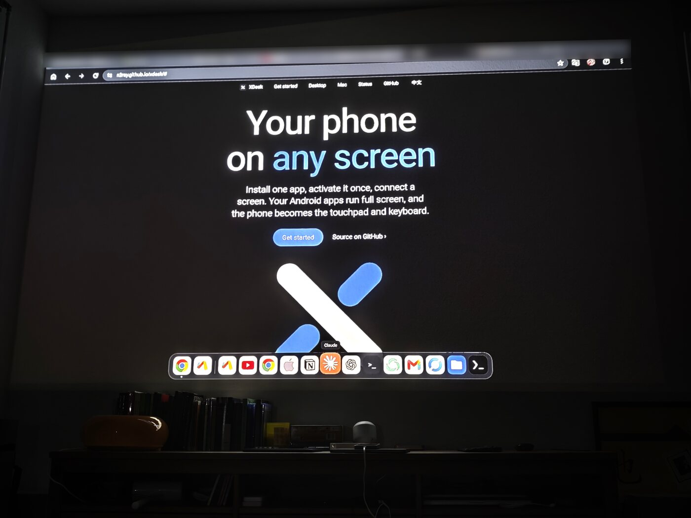
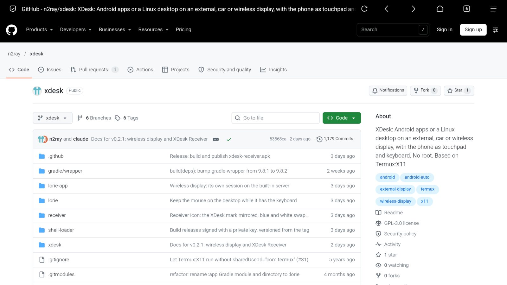
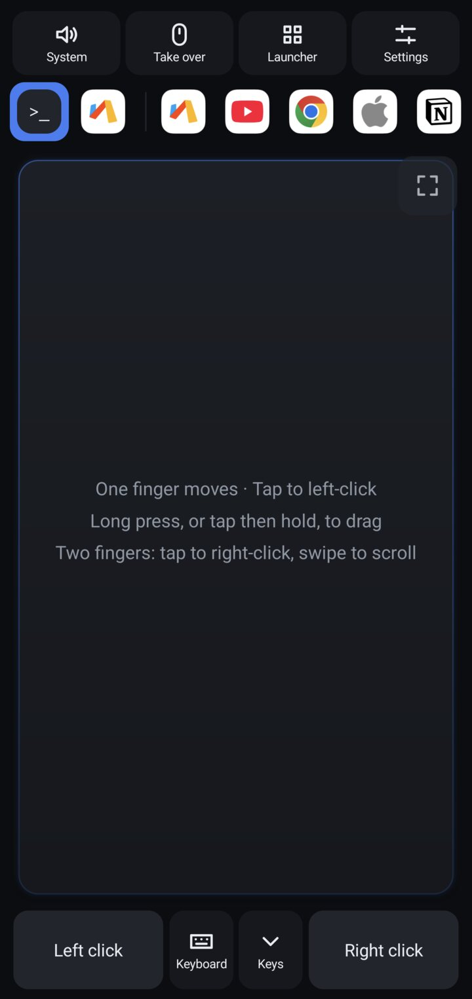
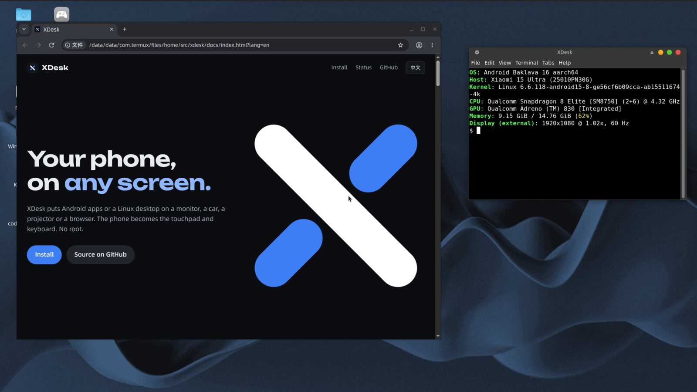

# XDesk

<p align="center"></p>

**手机里的应用，搬上大屏，不用 root。** 装个 APK，激活一次，插上显示器，应用就能在大屏上全屏运行，手机拿来当触摸板和键盘。外接屏首页是你的收藏，鼠标移到屏幕底边会升起 Dock，用起来很像一台电脑。想要更多的话，还可以用 Termux 跑 Linux 桌面，用 Wi-Fi 投到另一台安卓设备，用 Mac 上的 XDesk 当大屏，或者用浏览器当显示器。

| 屏幕 | 连接方式 |
|---|---|
| 显示器、便携屏或扩展坞 | USB-C 视频输出，延迟最低 |
| 车机 | Android Auto，只能停车时用（实验性） |
| 投影、电视盒子或旧手机 | Wi-Fi，投到 XDesk 接收器 |
| Mac（Apple 芯片） | USB 或 Wi-Fi，装 [XDesk Mac 版](#mac-接收端)，键鼠直接用 Mac 的 |
| iPad、电脑或智能电视 | 任意浏览器，那边什么都不用装 |

**[网站](https://n2ray.github.io/xdesk/?lang=zh)** · [English](README.md) · Linux 桌面基于 [Termux:X11](https://github.com/termux/termux-x11)（[上游说明](README.upstream.md)）· GPL-3.0 · [我和 AI Claude 一起做的](#我和-ai-一起做的)

> **现状：** 这还是个早期的个人项目，平时只在一台手机上用：欧版（EEA）小米 15 Ultra（型号 25010PN30G，骁龙 8 Elite，HyperOS 3，安卓 16，BL 未解锁）。其他机型基本没有测试过，包括这款手机的国行版，表现可能不一样，很欢迎告诉我结果。界面语言跟随系统，简体中文显示中文，其他语言显示英文，安卓 13 及以上也可以在 XDesk 的设置里单独选。

## 快速开始

安卓 11 及以上就行（目前只在安卓 16 上测过）。不用 root，不用电脑，也不用装别的 App。

### 1 安装 App

到[发布页](https://github.com/n2ray/xdesk/releases/latest)下载 `xdesk.apk`，装上就行。如果文件管理器提示“未安装应用”，就用 `adb install -r xdesk.apk`；小米手机要先在开发者选项里打开 **USB 安装**。

v0.2.0 起 APK 换了 XDesk 自己的签名。v0.1.x 用的是上游公开的测试签名，安卓不让直接升级，要先卸载旧版。

### 2 激活一次

安卓不让普通应用给别的应用发送键鼠操作，所以 XDesk 要借无线调试启动一个自带的小服务。打开 XDesk，照着激活页面做：

1. 连上 Wi-Fi。只有激活时要连，手机自己开的热点可能不行。
2. 在开发者选项里打开**无线调试**，点**使用配对码配对设备**。
3. 把 6 位配对码输进 XDesk 的通知或激活页面。
4. XDesk 要悬浮窗权限时点允许，否则大屏上没有光标。

小米手机还要在开发者选项里打开 **USB 调试（安全设置）**，并允许读取应用列表。已经在用 [Shizuku](https://shizuku.rikka.app/) 的话，直接用它也行。手机重启后要重新激活。

### 3 接上屏幕

用 USB-C 转 HDMI 线或扩展坞连上显示器，打开 **XDesk**，点一个应用。手机要支持 **USB-C 视频输出**（DisplayPort Alt Mode），插上显示器能镜像手机画面，就说明支持。

<p align="center"> </p>

### 想要更多的话

- [Linux 桌面](#通过-termux-使用-linux-桌面)，通过 Termux
- [用另一台安卓设备当显示器](#连接接收器)，走 Wi-Fi，对方装 XDesk 接收器
- [用浏览器当显示器](#网页显示)
- 通过 Android Auto 上车机，只能停车时用（见[功能](#功能)）

## 外接屏上的安卓应用

在选择界面点一个应用，它就在外接屏上全屏运行，手机当它的触摸板和键盘。

外接屏的首页以宫格显示手机上的“我的收藏”，点一下就打开，收藏在手机上管理。打开应用后，把鼠标移到屏幕最底边停一下，会升起 Dock，里面是当前应用、上一个应用和收藏，移开后自动收起。输入法打开时，Dock 显示在输入法上方。可以在设置 → **外屏**里关掉 Dock。Linux 桌面上没有 Dock。

实体鼠标和键盘默认归手机。想让外接屏直接用，点顶部的**接管**或按 Ctrl+Alt+M，点**交还**或再按一次就还给手机。接着实体键盘时，接管后输入法的候选词也会显示在外接屏上，就在输入框旁边。点**启动器**只是在手机上打开应用列表，外接屏上的内容不变，点**回到触摸板**关掉。

### 激活

安卓不让普通应用给别的应用发送键鼠操作，所以 XDesk 里带了一个小服务，以 shell 身份运行，由它读取 `/dev/input` 并发送操作。不用装别的 App，XDesk 会通过无线调试自己把它启动起来（需要安卓 11 及以上）。只用 Termux 桌面的话，不需要激活。

- 激活时要连着 Wi-Fi，没有 Wi-Fi 时安卓会关掉无线调试，手机自己开的热点可能也不行。服务跑起来之后，断开 Wi-Fi 也没关系。
- 配对只要做一次。以后打开 XDesk 时，只要无线调试开着，服务会自动启动。
- 手机重启后要重新激活。如果服务拿到了 `WRITE_SECURE_SETTINGS` 权限，XDesk 会在连着 Wi-Fi 时自己打开无线调试，服务启动后再关掉。有的系统不给这个权限，XDesk 会告诉你该怎么做。
- 服务运行期间，不要关闭 USB 调试或开发者选项。
- 结束 XDesk 后服务还在，但不再占用键鼠、声音和显示设置，而且只有 XDesk 能调用它。重启手机、更新或卸载 XDesk，或者在设置里点**停止内置服务**，它就停了。
- XDesk 的密钥会一直保持配对，直到你在开发者选项里撤销。无线调试开着时，这把密钥可以打开手机的 shell，和任何配对过的设备一样。
- 已经在用 [Shizuku](https://shizuku.rikka.app/) 的话，允许 XDesk 使用它就行，服务会通过 Shizuku 运行。
- 还需要悬浮窗权限。安卓自己的光标只留在手机屏上，外接屏上的光标要由 XDesk 来画。

### 操作

- **键鼠和触控两种模式。** 每个应用单独记住，默认是键鼠，光标样式能看出当前是哪种。
  - **键鼠模式**用黑色箭头，手机的触摸板、按钮、按键和实体键鼠都能用。
  - **触控模式**给只认触摸的应用和网页用，光标是圆润的黑色箭头，不动时会隐藏。一根手指移动光标，轻点就是点按，轻点后按住滑动是拖动，按住不动是长按。两到五根手指是真正的多指操作，捏合和滑动都能用，外接屏上会显示每根手指的位置。这时实体鼠标也当手指用：左键一根，右键两根，滚轮是滑动。
- **全屏触控区。** 点触控区角上的图标，它会铺满整个手机屏并隐藏系统栏，XDesk 会记住。角上的半透明小图标可以返回、打开键盘和退出全屏，手机的返回手势也能退出。键鼠模式下左右键会隐藏，用轻点、双指轻点和长按拖动代替。
- **返回键。** **返回 App** 会把返回操作发给外接屏上的应用，鼠标侧键是后退和前进。RustDesk 会话中，侧键仍然交给 RustDesk。返回后外接屏上没有应用的话，手机会打开应用列表。
- **键盘。** 应用弹出的软键盘显示在手机上。手机键盘只能发送键盘能打出来的字符，中文等输入法的文字到不了安卓应用，要用实体键盘接管。接管时才会改外接屏的输入法设置，交还、会话结束或服务退出时都会恢复。

### 切换和结束

- **Dock。** 选择界面可以按名字或包名搜索，点一行右边的星加到 Dock。长按图标会打开应用卡片，可以调 Dock 位置、界面大小、鼠标或手指模式，也可以关闭应用。Dock 一直在触摸板界面上，点一下就切换外接屏上的内容。
- **后台运行。** 已经在运行的应用切回来时状态还在。只要安卓没有关掉它们，桌面和应用可以互相留在后面继续运行。应用在前面时，桌面没有声音。
- **仪表盘。** XDesk 开着又接了外接屏时，外接屏最底层显示时钟和状态，应用退出后看到的就是它。
- **结束会话。** 回到启动器或手机桌面都不会结束会话，接管的键鼠也还在。点**结束 XDesk**，或者从最近任务里划掉 XDesk，才会结束：外接屏上的应用移回手机（不会关闭），外接屏恢复镜像，键鼠、声音和界面大小都还原。Termux 桌面继续运行，只是没有窗口，启动器上会显示运行中。移回应用要靠注入服务，服务不在时应用会留在外接屏上，XDesk 会提示。
- **XDesk 不会自己重启桌面。** X 服务器停了的话，启动器会告诉你，点一下就能重新启动。

### 界面大小

外接屏上放安卓应用时，可以在设置里填 120 到 220 dpi 作为默认值，每台显示器分别记住。单个应用也可以在卡片里设自己的值。只有数值变化时才会真正修改，因为应用要重新布局。光标大小按显示器高度计算，不受影响，会话结束时恢复。

显示 Termux 桌面时用的是另一个值，默认 168 dpi，在同一个地方设置。它只影响外接屏上的安卓窗口，比如输入法候选词，桌面本身用自己的 DPI 设置。这项功能需要注入服务。

### RustDesk

- 远程会话中，XDesk 的光标是一个淡淡的小圆点，不挡远程光标，在 RustDesk 自己的界面上也看得到。在工具栏上和点完工具栏的几秒内，光标会恢复正常。判断是否在远程会话，靠的是一个版本上观察到的窗口标志，判断错了可以打开“始终显示 XDesk 光标”。
- RustDesk 的拖动在普通鼠标事件下有问题（Flutter 的原因），所以 XDesk 把按键变化当悬停事件发送，并靠推测判断一次点击是不是点在工具栏上。RustDesk 更新后可能失效。需要特殊处理的应用列在 `AppInputProfile.java` 里，其他应用用普通的安卓鼠标事件。

## 通过 Termux 使用 Linux 桌面

<p align="center"></p>

这部分是可选的，只用安卓应用的话可以跳过。先装好 [Termux](https://github.com/termux/termux-app)，然后在里面运行：

```sh
curl -fsSL https://raw.githubusercontent.com/n2ray/xdesk/xdesk/xdesk/install.sh | bash
```

它会安装 `xdesk` 命令和加载器，找出你已有的桌面，还会下载 App，已经装过的话不用管。还没装桌面的话，可以运行 `pkg install xfce4 xfce4-terminal && xdesk setup`。之后这些桌面就会出现在 XDesk 的启动器里。

> 运行之前建议先看看脚本：[install.sh](xdesk/install.sh)。

桌面和 XDesk 是分开的：打开或划掉 XDesk 都不会启动或结束 XFCE，桌面只是启动器里的一项，由你自己决定开关。

XDesk 只负责显示，任何能连上它的 X socket 的程序都能显示出来：

```sh
xdesk x                 # 只启动 X 服务器和声音
xdesk run 命令...        # 在显示器上运行任意程序
xdesk setup             # 查找 Termux 和 proot-distro 里的桌面
xdesk list              # 列出环境，* 是默认
xdesk use 名字           # 选默认环境
xdesk start [名字]       # 启动环境
xdesk switch 名字        # 结束当前环境并启动另一个，窗口不断
xdesk add 名字 '命令'    # 添加自己的环境
xdesk rm 名字            # 删除环境
xdesk status            # 查看运行状态
xdesk stop              # 全部结束
```

一个环境就是一条命令，保存在 `~/.config/xdesk/sessions/名字.sh`。这些文件可以随便改，`xdesk setup` 不会覆盖。

| 环境 | 怎么连接 |
|---|---|
| Termux | `xdesk setup` 会自动找到，或者直接 `xdesk run xterm` |
| proot-distro | `xdesk setup` 会自动找到。手动添加：`xdesk add box "proot-distro login ubuntu --shared-tmp -- env DISPLAY=:1 PULSE_SERVER=127.0.0.1 PULSE_COOKIE=/tmp/xdesk-pulse-cookie dbus-launch --exit-with-session startxfce4"` |
| 手动 proot | 把 `$PREFIX/tmp` 绑定到 `/tmp`，设置 `DISPLAY=:1` |
| chroot（要 root） | 把 `$PREFIX/tmp/.X11-unix` 绑定到 chroot 里的 `/tmp/.X11-unix`，设置 `DISPLAY=:1`。目前没有测试过 |

GPU 加速只为骁龙（Adreno）手机上的 Termux 配好了（zink + Turnip）。proot 和 chroot 里默认是软件渲染，除非你自己配置 Mesa，调试够用，玩游戏不行。

proot 和 chroot 里的声音通过 `127.0.0.1` 上的 PulseAudio 传给 App。

### 从 App 启动

点启动器里的环境就能启动它，这需要在 Termux 里运行命令的权限。没有权限时，启动器会显示**接上 X 显示**，你可以自己运行 `xdesk start`。要开启权限，运行：

```sh
xdesk enable-app-start
```

这条命令会在 Termux 里设置 `allow-external-apps = true`。XDesk 还要单独获得授权，第一次点环境时会询问。

正在运行的环境在启动器上有标记，点它只是接回画面，不会重启。离开 XDesk 不会结束桌面，要结束的话，用那一行的**结束**按钮、设置里的同名选项，或者运行 `xdesk stop`。

## 连接接收器

没有线的话，可以在同一网络的另一台设备上装 **XDesk 接收器**（[发布页](https://github.com/n2ray/xdesk/releases)里的 `xdesk-receiver.apk`），旧手机、投影、电视盒子都行，要求安卓 5.0 及以上。用起来和接线一样，安卓应用、Termux 桌面和声音都有。接收器只负责显示画面和播放声音，所有操作都在手机上。

1. 在另一台设备上打开 XDesk 接收器，它会显示自己的名字和地址，然后等待连接。
2. 在 XDesk 里打开设置 → **外屏** → **连接接收器**，选择这台接收器。不在同一网段搜不到时，点**输入地址**，填接收器上显示的地址。
3. 第一次连接时，输入接收器上显示的 4 位配对码，以后就不用再输了。

- **需要注入服务**（内置服务或 Shizuku），投过去的显示器是它创建的。开关应用不会影响投屏，万一显示器丢了，XDesk 会重新建一块。
- **画面**是 H.264，分辨率跟随接收器屏幕，长边最多 1920，并且不超过它的解码能力，1080p 约 12 Mbit/s。
- **声音**是手机的全部输出，在接收器上播放，手机这边静音。它和有线外接屏用同一个声音设置：选系统默认时声音跟着屏幕走，这里就是接收器；选手机上的输出（比如耳机）时声音留在手机上。投屏过程中随时可以换。
- **停止投屏**：在同一个设置项里停止、点**结束 XDesk**，或者关掉接收器都行。
- **安全：** 配对之后，双方只证明自己持有令牌，不会发送令牌本身。但配对码、配对时下发的令牌、画面和声音都没有加密，所以配对只能防止别的手机误投，防不了能监听网络的人。协议见 [receiver/PROTOCOL.md](receiver/PROTOCOL.md)。

## Mac 接收端

手机的画面和声音显示在 Mac 窗口里，键盘鼠标直接用 Mac 的。支持 Apple 芯片的 Mac，[下载 `XDesk-macos-arm64.dmg`](https://github.com/n2ray/xdesk/releases/latest/download/XDesk-macos-arm64.dmg)，手机和 Mac 两边的版本要一致。我测试时，USB 下从手机到 Mac 约 15 到 20 毫秒。

- **第一次打开：** 应用是自签名的，macOS 会拦下，到 **系统设置 → 隐私与安全性** 里点“仍要打开”。然后在 **辅助功能** 里打开 XDesk，键盘才能交给手机，窗口里会有提示，不用重开。
- **连接：** 插上数据线并打开 USB 调试，会自动走 USB，拔线后回到 Wi-Fi。没插线时，在手机 XDesk 的“连接接收器”里选这台 Mac。第一次要输配对码。
- **操作：** 鼠标停在窗口顶边会出现返回、主页、最近、全屏、断开按钮，菜单栏“手机”里也有。把文件拖进窗口，会传到手机的“下载”。在手机上用系统分享选“发送到电脑”，文件会传到 Mac 的“下载”。Mac 和手机的文字剪贴板互通，可以在“连接接收器”里关掉。在 XFCE 里打字用 Mac 自己的输入法，切换键 Ctrl+空格 也归 Mac；安卓应用里用手机的输入法。
- **快捷键：** Control+Option 加 Esc（把键鼠还给 Mac）、F（全屏）、B（返回）、H（主页）、R（最近）、D（延迟面板）、L（低延迟模式）。

## 网页显示

有浏览器的设备都能当显示器，比如 iPad、电脑、智能电视，什么都不用装。在设置 → **外屏** → **网页显示**里打开，XDesk 会在 47150 端口提供网页，并列出可以打开的地址：

- **无线：** 手机的 Wi-Fi 地址。对方连手机热点时，用热点的地址。
- **有线：** 插上数据线，打开 **USB 网络共享**（这一行会跳到系统设置），就会多一个有线地址，延迟比 Wi-Fi 低，也更稳。iPad 和 Mac 只认 NCM，要先点 **USB 网络共享用 NCM**（需要内置服务给的权限，否则运行 `adb shell settings put global tether_force_usb_functions 1`），再把网络共享关掉重开。

第一次打开时，要输入手机上显示的 4 位码，之后浏览器会记住这台手机。画面和声音传到浏览器，鼠标、键盘和触摸传回手机：

- **鼠标：** 用的是电脑自己的光标，速度和平时一样，没有延迟。这时桌面的光标是隐藏的，所以光标形状不会随文字或链接变化。用手机触摸板时，桌面光标会回来，电脑光标隐藏，再动鼠标又切回去。需要相对移动的游戏，可以在地址后面加 `?lock` 锁定鼠标，按 Esc 解锁。
- **触摸：** 和手机上的触摸板一样。单指移动，轻点是单击，点一下再按住是拖动，双指滚动，双指轻点是右键，三指轻点是中键。
- **键盘：** 打出来的字符就是电脑键盘实际打出的字符，德语苹果键盘也一样。快捷键都能用，Mac 和 iPad 键盘上的 Command 相当于 Ctrl。中文输入法和 iPad 软键盘（点 ⌨）打的字也能传过去。
- **接管：** 浏览器连上后自动接管，手机没接键鼠也可以，这时手机输入法的选词框显示在网页里。点**交还**后，手机屏幕键盘恢复正常。
- **工具栏：** 把鼠标移到顶边或点屏幕顶边，会出现全屏、键盘、声音和断开。页面拦住了后退，离开前会确认，也不会缩放、滚动或弹出菜单。Chrome 全屏时，Esc 和浏览器快捷键也会传给外屏。iPad 上**添加到主屏幕**后，可以像 App 一样全屏打开。

它和连接接收器共用一套机制，所以同一时间只能连一个浏览器或接收器，需要注入服务，手机上要开着 XDesk。网页走普通 HTTP，配对令牌、画面、声音和键鼠都没有加密，只在信得过的网络里用。

想让它像单独的窗口，可以用浏览器全屏，或者在桌面版 Chrome 里创建快捷方式并选择在窗口中打开。视频是 H.264，浏览器允许时用 WebCodecs 解码（localhost 或 HTTPS），否则用 Media Source Extensions，普通 HTTP 下 Safari、Chrome、Edge、Firefox 都能用。网页和协议见 `lorie-app/src/main/assets/web/` 和 [receiver/PROTOCOL.md](receiver/PROTOCOL.md)。

## 功能

- 手机当触摸板：移动、轻点、双指右键和滚动，长按或轻点后按住拖动
- 软键盘支持输入法打字（包括中文），还有快捷键栏（Esc、Tab、Ctrl、Alt、Super、Shift、方向键）
- 支持实体鼠标和键盘。点**接管**后键鼠直接交给桌面窗口，输入法候选词显示在外接屏上，点**交还**回到手机。接管需要注入服务
- 安卓应用在外接屏上全屏运行
- 外接屏首页以宫格显示手机上的“我的收藏”。在安卓应用上，鼠标停在屏幕底边会升起 Dock，里面是当前和上一个应用，以及收藏，可以在设置里关掉
- 连接接收器：通过 Wi-Fi 把画面和声音投到投影、电视盒子或旧手机上
- Mac 版：USB 或 Wi-Fi 连接，自动切换线路，文字和文件互传，见 [Mac 接收端](#mac-接收端)
- 声音输出可选：手机扬声器、HDMI、蓝牙、USB、有线耳机或系统默认，所有模式共用一个设置。注入服务运行时，它会设置系统的首选媒体设备，桌面、安卓应用和其他声音都生效，回到选择界面或退出时清除。没有注入服务时只能尽量指定桌面声音，在测试手机上，接着 HDMI 时没法切回手机扬声器。这里只是选择输出设备，不影响音质或蓝牙编码。如果 XDesk 被强行结束、来不及清除，在 XDesk 里选一次系统默认，或者重启手机
- 分辨率档位、灵敏度、触控界面横竖屏、闲置时调暗手机屏
- 拔掉显示器、切换 App、锁屏后都能恢复
- Android Auto（实验性，只能停车时用）：XDesk 会出现在车机的应用列表里，车机上显示时钟。可以把 Linux 桌面放到车机上，分辨率跟随车机屏，手机当触摸板和键盘，声音从车里出。YouTube、Chrome 等安卓应用也能上车机，可以直接点车机屏幕操作。同时接着外接屏时，优先用外接屏

可以和官方 Termux:X11 同时安装，互不影响，但不要同时运行，两者都用 `:1`。

## 工作原理

```
 手机屏                              外接屏
┌───────────────────────┐           ┌───────────────────────┐
│ XDeskActivity         │  直接     │ MainActivity（上游）   │
│ 触摸板、按键、声音    ├──调用────►│ LorieView 显示 X       │
└───────────┬───────────┘           └───────────▲───────────┘
            │ 本机端口（声音）                  │ X11 socket
┌───────────▼───────────────────────────────────┴───────────┐
│ xdesk：X 服务器、PulseAudio                                │
│ Termux、proot、chroot：你的桌面或程序                      │
└───────────────────────────────────────────────────────────┘
```

- **一个 App，两个窗口。** 上游的 `MainActivity` 原样放在外接屏上，`XDeskActivity` 在手机屏上。两者在同一个进程，直接调用 `LorieView.sendMouseEvent`、`sendKeyEvent`、`sendTextEvent`。
- **X 服务器在 Termux 里运行**，用的是为这个包名构建的加载器。
- **安卓应用**由注入服务（`InjectorService`）放到外接屏上。它以 shell 身份运行，用 `injectInputEvent` 发送操作，光标由 `CursorOverlay` 绘制。
- **声音**从 PulseAudio 的 null sink 经 Termux 私有目录里的 socket 传出，由 X 服务器把连接转交给 App，App 再用 `AudioTrack` 播放，所以不需要特殊权限就能选输出设备。proot 或 chroot 里的程序用 cookie 连接 `127.0.0.1:4713`，因为手机上所有 App 都能连到这个端口。`xdesk` 会为自己的会话和 proot-distro 会话设好 `PULSE_COOKIE`。自己配的 chroot 要把它设成从 chroot 里看到的 `$PREFIX/tmp/xdesk-pulse-cookie`。实在做不到的话，`touch ~/.config/xdesk/pulse-anonymous` 可以恢复不用 cookie 的旧方式，但手机上任何 App 都能录下桌面声音、控制 PulseAudio。
- **连接接收器：** 注入服务创建一块公开显示器，画面直接进 MediaCodec H.264 编码器，再用 `REMOTE_SUBMIX` 录下手机的声音（`WirelessDisplay`、`OutputCapture`）。XDesk 连接接收器的 47140 端口，把这块显示器当外接屏用。

改动几乎都在 `lorie-app/` 和 `xdesk/` 里，合并上游比较简单。

## 常见问题

日志在 `$PREFIX/tmp/xdesk.log`。

| 现象 | 可能的原因 |
|---|---|
| 一直在等待 | 你接上了 X 显示，但还没有程序在运行。运行 `xdesk start`，再用 `xdesk status` 看看 |
| 选择界面没有环境 | 运行 `xdesk enable-app-start` 和 `xdesk setup`，并允许 XDesk 运行 Termux 命令 |
| 安卓应用列表不全 | 有些系统限制应用读取列表。小米手机检查“获取应用列表”权限 |
| 注入服务启动不了 | 确认连着 Wi-Fi、无线调试开着，再回到 XDesk。手机重启后要重新激活。用 Shizuku 的话，确认它在运行 |
| 配对失败，或者通知里输入不了 | 配对框要一直开着。在 XDesk 的激活页里输入配对码，离开设置配对框就关闭的话，用分屏或小窗 |
| 提示 “Display :1 is used by another X server” | 官方 Termux:X11 在运行，先结束它，比如 `pkill -f termux-x11` |
| App 的启动按钮不起作用 | 运行 `xdesk enable-app-start`，再检查权限 |
| 桌面没有铺满屏幕 | 桌面在 App 连上之前就启动了。先打开 App，再重启环境 |
| 外接屏闲置几分钟后黑屏 | XFCE 的屏保。动一下鼠标，或者调大 xfconf `xfce4-screensaver` 的 `/saver/idle-activation/delay` |
| 手机屏上出现安卓光标 | 鼠标抓取丢了，点一下 XDesk 的手机界面 |
| 没有声音 | 看看顶部的声音输出，很多显示器没有喇叭 |
| 软键盘上 Ctrl + 字母没反应 | 拼音模式下字母留在输入法里，切到英文布局或用实体键盘 |
| 小米手机上安卓应用收不到输入 | 在开发者选项里打开 **USB 调试（安全设置）** |
| 车机上用 GPU 的程序出现闪烁的色块 | Android Auto 显示器的合成打断了 Turnip 的分块渲染。用 `TU_DEBUG=sysmem` 启动它们；Chromium 再加 `--use-angle=gl --disable-features=Vulkan` 还更快 |

## 局限

- 安卓应用要用无线调试或 Shizuku 激活，外接屏同一时间只能放一个全屏应用或桌面
- Android Auto 只能停车时用。Android Auto 关掉 XDesk 或断开后，桌面和安卓应用都继续运行，在车机上重新打开 XDesk 就能回来。有 DRM 的视频（部分流媒体应用）在车机上可能黑屏。车机上的安卓应用同样要先激活，会话结束时回到手机
- Termux 和 XDesk 都要保持运行，系统清理可能会杀掉它们
- 连接接收器：一台接收器同时只接一台手机，只传画面和声音，流畅程度取决于 Wi-Fi。在一台 32 位安卓 9 投影上测试过
- 日常只在欧版小米 15 Ultra 上使用，别的机型基本没有测试过
- Mac 版只支持 Apple 芯片，只在一台 M4 Mac 上测试过。应用是自签名的，走 Wi-Fi 时和其他无线模式一样没有加密。在 Linux 桌面里用 Mac 输入法时，候选框在鼠标下方，不跟随文字光标。暂时没有 Windows 和 Linux 版

## 构建

默认分支是 `xdesk`，`master` 跟随上游。推送后由 GitHub Actions 构建，`v0.2.0` 这样的标签会发布 Release，用仓库 secrets 里的密钥签名（见 `.github/workflows/release.yml`）。带后缀的标签（如 `v0.3.0-rc1`）发布为预发布版本。

```sh
git clone --recursive https://github.com/n2ray/xdesk
cd xdesk && ./gradlew assembleDebug      # 需要 Android SDK 和 NDK
```

合并上游：

```sh
git remote add upstream https://github.com/termux/termux-x11
git fetch upstream && git merge upstream/master
```

Mac 版的代码在 `desktop/`，用 Rust 写的。在 Mac 上装好 Rust 和 `sdl2`（Homebrew），在这个目录运行 `cargo build --release`。打包脚本是 `desktop/packaging/build-app.sh`。

XDesk 依赖上游的 manifest、`com.termux.x11` 下的类名和 `LorieView` 接口。包名在 `lorie-app/build.gradle` 和 `shell-loader/build.gradle` 里设置，两边要一致。

## 我和 AI 一起做的

我是 [n2ray](https://github.com/n2ray)，XDesk 是我和 AI Claude 一起做的。我决定做什么，并在真实的手机、显示器、投影、车机和 Mac 上测试。大部分代码和文档是 Claude 写的，这份 README 也是。

## 许可证

GPL-3.0，和 Termux:X11 相同。X 服务器和渲染的功劳都属于 [Termux:X11 的作者们](https://github.com/termux/termux-x11)。
